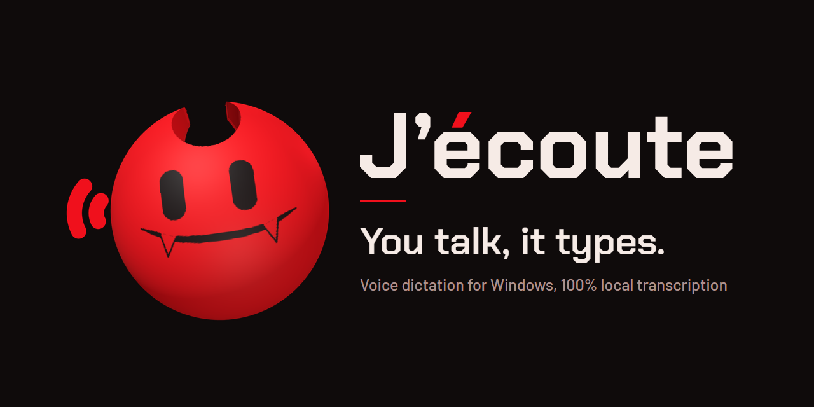
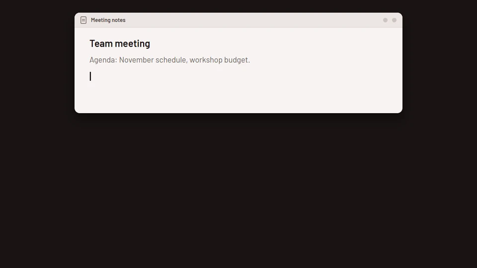
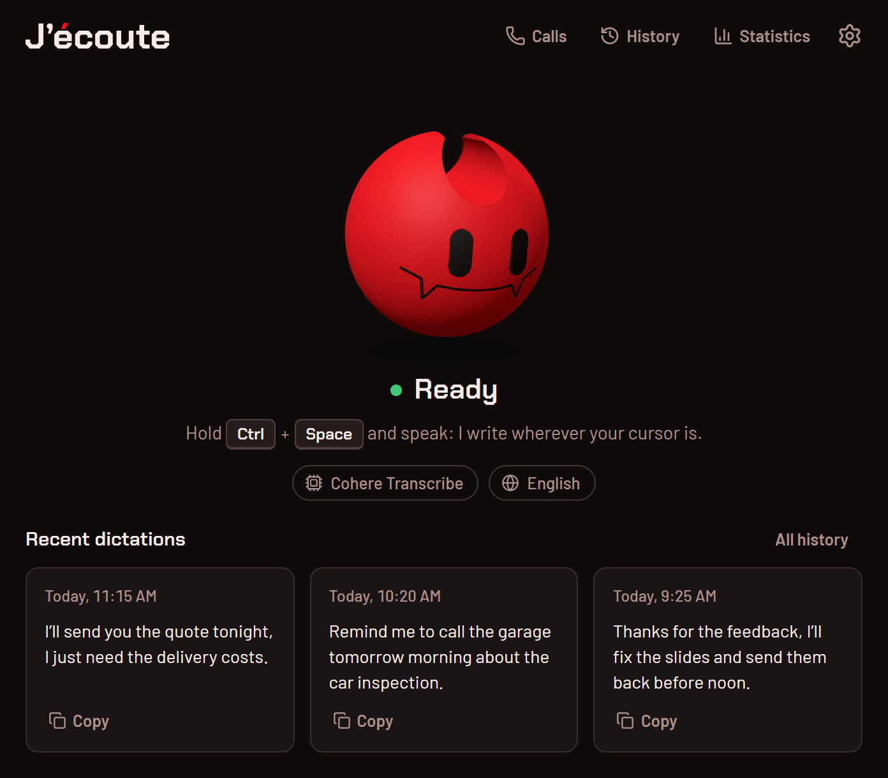
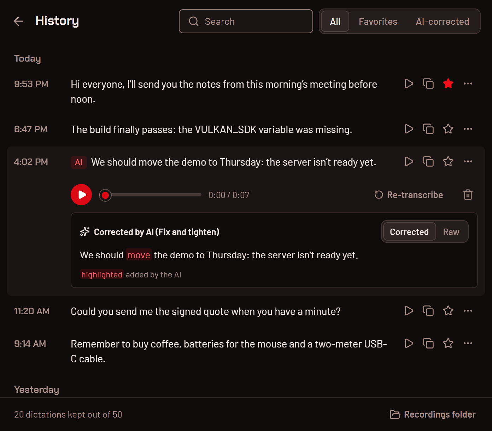

<p align="center">
  
</p>

<p align="center">
  <a href="README.md">Français</a> · <b>English</b>
</p>

<p align="center">
  <b>Hold Ctrl+Space, speak: your words appear wherever your cursor is, and your voice never leaves your PC.</b><br>
  <sub>Windows 10 and 11, 64-bit · free · MIT-licensed code</sub>
</p>

<p align="center">
  
</p>

VIDEO_TEASER_16_9

<p align="center"><sub>Screenshots and videos use made-up dictations.</sub></p>

---

## What it does

J’écoute (“I’m listening” in French) is voice dictation for Windows. Hold a shortcut, speak, let go: the text lands in
the app you are using, as if you had typed it.

- **It types anywhere.** Email, documents, chat, terminal, web forms: anywhere there is a cursor.
- **It stays on your machine.** Transcription runs on your PC, on the graphics card (Vulkan) or the processor. No
  account, no subscription, and it works offline once the model is downloaded.
- **You pick the model.** 69 models, sorted for your language: Cohere Transcribe for accuracy, Parakeet for speed,
  and models that write live while you speak.
- **Your dictations stay at hand.** The last three sit on the home screen, one click copies them. The history keeps
  them with their recording.
- **An AI can polish it, if you want.** A second shortcut has the text corrected (punctuation, rewording) by the
  provider you choose. It is off by default.

## The character

While you dictate, a small red horned character pops up at the bottom of the screen. It leans in to listen while you
speak, nodding now and then, then types your sentence on a tiny keyboard, or whispers while the AI reviews it. Once
the text is pasted, it slips away.

<table>
  <tr>
    <td align="center" width="25%"><br><sub>it pops up</sub></td>
    <td align="center" width="25%"><br><sub>it listens</sub></td>
    <td align="center" width="25%"><br><sub>it types your sentence</sub></td>
    <td align="center" width="25%"><br><sub>it whispers, the AI reviews</sub></td>
  </tr>
</table>

Between dictations, it lives in the middle of the window: it follows your mouse with its eyes, stretches, yawns, waves,
reacts when you click on it, and dozes off if you leave it alone.

<table>
  <tr>
    <td align="center" width="25%"><br><sub>idle</sub></td>
    <td align="center" width="25%"><br><sub>it follows your mouse</sub></td>
    <td align="center" width="25%"><br><sub>click on it</sub></td>
    <td align="center" width="25%"><br><sub>it falls asleep</sub></td>
  </tr>
</table>

All its moods and animations: **[docs/en/character.md](docs/en/character.md)**.

## The app

<table>
  <tr>
    <td align="center" width="50%">
      <picture>
        <source media="(prefers-color-scheme: dark)" srcset="docs/media/en/accueil-sombre.png">
        <source media="(prefers-color-scheme: light)" srcset="docs/media/en/accueil-clair.png">
        
      </picture>
      <br><sub>home: status, model, language, recent dictations</sub>
    </td>
    <td align="center" width="50%">
      <picture>
        <source media="(prefers-color-scheme: dark)" srcset="docs/media/en/historique-sombre.png">
        <source media="(prefers-color-scheme: light)" srcset="docs/media/en/historique-clair.png">
        
      </picture>
      <br><sub>history: search, favorites, playback, raw or corrected</sub>
    </td>
  </tr>
</table>

## Install

1. **Download** `Jecoute_<version>_x64-setup.exe` from the
   [releases](https://github.com/ponthieutheo/jecoute/releases/latest) page (Windows 10 or 11, 64-bit).
2. **Run it.** The installer is not signed (it has no code signing certificate), so Windows does not know it yet:
   SmartScreen may say “Windows protected your PC”. Click “More info”, then “Run anyway”.
3. **Pick your model** on first launch. J’écoute suggests three, chosen for your language and your machine. It is
   downloaded once; after that, everything works offline.

The installer also offers a portable install (a self-contained folder, data included). Checking the download,
updating, uninstalling: **[docs/en/installation.md](docs/en/installation.md)**.

## Use

1. Put your cursor where you want to write.
2. Hold **Ctrl+Space**, speak, let go: the text is pasted.
3. Rather not keep the keys down? A short press starts the dictation, a second one stops it.

| Keys                 | What it does                                                               |
| -------------------- | -------------------------------------------------------------------------- |
| **Ctrl+Space**       | hold to dictate, or press once to start and once to stop                   |
| **Esc**              | cancels the current dictation without writing anything                     |
| **Ctrl+Shift+Space** | dictates, then has the AI review the text, once AI correction is turned on |

Everything else is in the window’s gear menu: the shortcut, the microphone, how the text is written, what shows up
during a dictation. “Every change applies right away.”

## Privacy

Transcription is 100% local: your voice is transcribed on your PC, and the audio never leaves it. J’écoute only goes
online to:

- **download a model**, from Hugging Face, when you pick one;
- **check for updates**, on GitHub (you can turn it off: Settings › App);
- **AI correction**, only if you turn it on with an online provider: the dictated text (not the audio) goes to that
  provider when you use Ctrl+Shift+Space.

No account, no usage statistics. The details, and where your data lives: **[docs/en/privacy.md](docs/en/privacy.md)**.

## Which model

| Your machine                          | For French                                                               | For English                                         |
| ------------------------------------- | ------------------------------------------------------------------------ | --------------------------------------------------- |
| with a graphics card                  | **Cohere Transcribe** (1.6 GB): the most accurate                        | **Cohere Transcribe** (1.6 GB)                      |
| without a graphics card, or for speed | **Parakeet TDT 0.6B v3** (705 MB): fast, detects the language on its own | **Parakeet Unified EN 0.6B** (697 MB): live English |

On first launch, J’écoute makes this choice for you. You can download others and switch between them from the home
screen. Comparing models: **[docs/en/models.md](docs/en/models.md)**.

## Everything you can do

- Change the shortcut, and choose between holding the keys and pressing to start.
- Pick the microphone, mute the computer while you dictate, add a sound signal at the start and the end.
- Paste or type the text, submit it with Enter for you, remove the “uh”s, teach it your names and technical terms.
- Have an AI review the text with your own instructions, then compare the raw and corrected versions word by word.
- Choose what shows up during a dictation: the character, a minimal pill, live text, or nothing.
- Find, replay, re-transcribe or star a dictation.
- Set up the interface (26 languages, light or dark) and launching with Windows.

The full tour, one picture per feature: **[docs/en/features.md](docs/en/features.md)**.

## Troubleshooting

### Ctrl+Space does nothing

Another app may already use that shortcut: input method switching (Chinese, Japanese, Korean), a launcher, or another
dictation tool. Pick a different one in **Settings › Dictation › Dictation shortcut**: click the pencil, then press
the keys you want.

### “I can’t use the microphone”

Windows is blocking the microphone for J’écoute. Click “Open microphone settings” under the character, or go to
Settings → Privacy & security → Microphone and allow microphone access, including for desktop apps.

### The wrong text gets pasted

If the transcription is right in **History** but J’écoute pastes something you copied earlier: J’écoute pastes
through the clipboard, then puts your previous clipboard back after a short delay. A slow app may read the clipboard
too late.

1. Show the debug tools with **Ctrl+Shift+D** in the J’écoute window (or Settings › App › Advanced options › “Debug
   mode”): the “Debug” section appears at the bottom of the App tab.
2. Turn on “Reliable Paste (Beta)”.
3. If that is not enough, increase “Paste Delay (After)”.

<a id="macos-secure-input"></a>

### macOS: the shortcut stopped responding (Secure Input)

_J’écoute 0.1.0 is only released for Windows: this section is for you if you build the app yourself on macOS._

**Symptom**: a shortcut that includes a regular key (for example Option+Space) no longer triggers, while a
modifier-only shortcut (fn alone, Left Ctrl alone) still works. This is macOS Secure Input: when a password field or
an app turns it on, macOS stops sending keystrokes to other apps, J’écoute included.

**Finding the culprit**: J’écoute then shows a banner at the top of the home screen and a ⚠ in its menu bar menu.
The banner names the app holding Secure Input when it can; that name is a best guess, not a certainty. To check by
hand, in Terminal:

```bash
ioreg -l -w 0 | grep -o 'kCGSSessionSecureInputPID"=[0-9]*' | grep -o '[0-9]*' | head -1 | xargs ps -o pid,comm -p
```

The command prints nothing if the offending app has already quit. In the **Debug** section (Cmd+Shift+D), the
**Keyboard Diagnostic** shows whether keystrokes reach J’écoute at all.

**Fixes, in order**:

1. **Terminal or iTerm2**: turn off “Secure Keyboard Entry” in the app’s menu.
2. **Password manager**: quit or update it. Some releases of 1Password and KeePassXC keep Secure Input on in the
   background.
3. **Otherwise** (stuck login window, an app that quit without releasing Secure Input): lock the screen with
   Ctrl+Cmd+Q, then log back in by typing your password (Touch ID is not enough). If that does not help, log out and
   back in.

Until then, J’écoute routes the affected shortcuts through a fallback, with a few limits: fn + key shortcuts stop
working entirely, a one-sided modifier (Right Option, for example) responds on both sides, and new shortcuts cannot
be recorded. Modifier-only shortcuts are never affected, which makes them a good choice if this keeps happening.

## Credits

J’écoute is based on **[Handy](https://github.com/cjpais/Handy) by CJ Pais**. It is an independent fork, neither
affiliated with nor endorsed by Handy or its author.

Thanks as well to the projects that make local transcription possible: [ggml](https://github.com/ggml-org/ggml) and
transcribe.cpp for inference, the Whisper, Parakeet, Canary, Cohere Transcribe models and every other one in the
catalog (converted to GGUF by Handy, on Hugging Face), Silero for voice detection, and [Tauri](https://tauri.app) for
the app.

## Licenses

- **Code**: MIT license, see [LICENSE](LICENSE) (copyright CJ Pais and Théo Ponthieu).
- **The character** (its 3D model, face, animations and images):
  [PolyForm Noncommercial 1.0.0](src/character/LICENSE), “Copyright (c) 2026 Théo Ponthieu”. Free to use, change and
  share for noncommercial purposes. For commercial use of the app, remove it or get its author’s permission. This
  covers `src/character/`, `src/assets/perso/`, `docs/media/perso/` and the app icons (`src-tauri/icons/`,
  `src-tauri/resources/`, `src-tauri/nsis/`); each of these folders carries its license file.
- **Fonts**: Chakra Petch and Barlow, SIL Open Font License 1.1 (`src/assets/fonts/`).

Building the app: [BUILD.md](BUILD.md) · Contributing: [CONTRIBUTING.md](CONTRIBUTING.md) · Reporting a
vulnerability: [SECURITY.md](SECURITY.md). These three guides are in French; English is welcome in issues and pull
requests.
