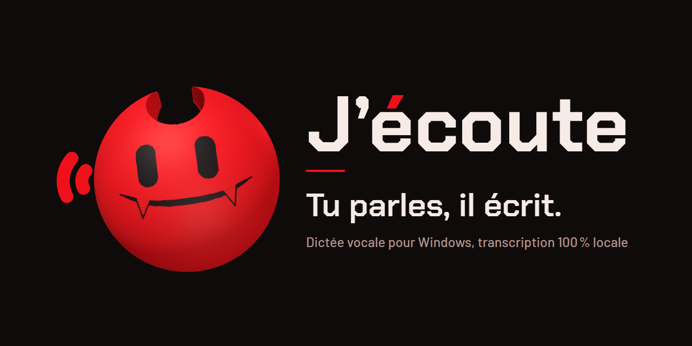
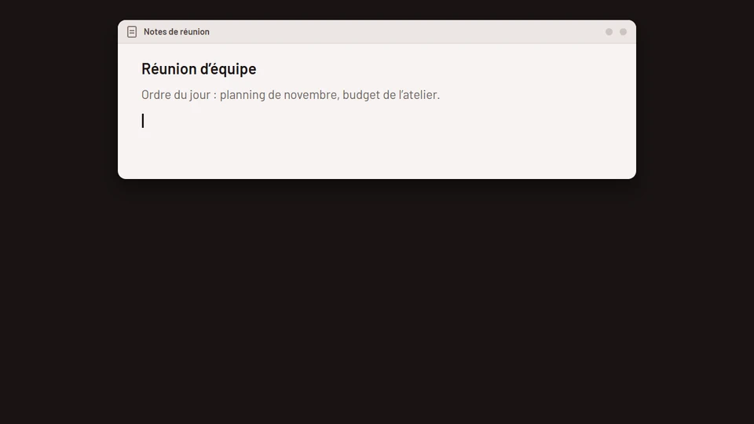
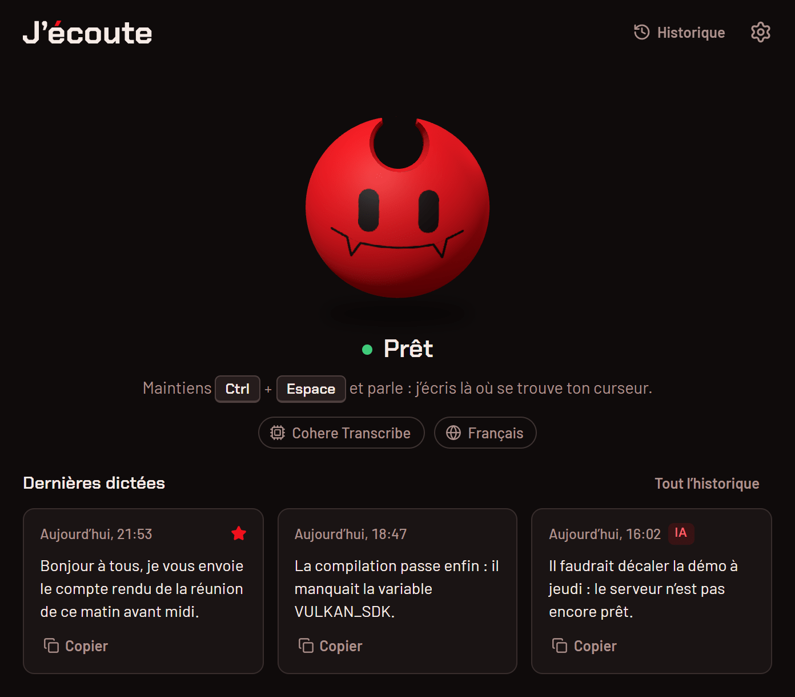
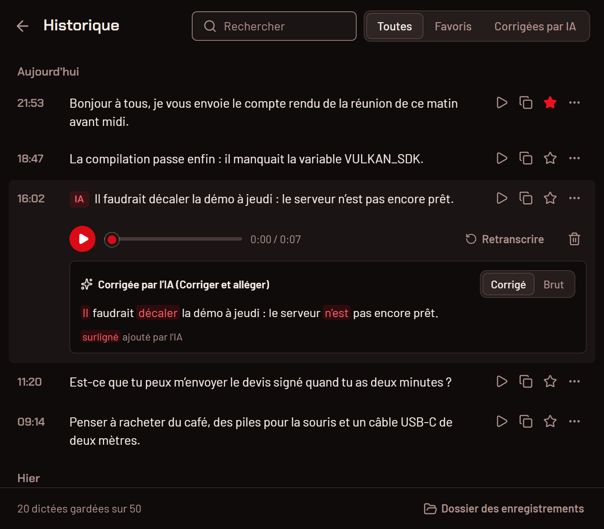

<p align="center">
  
</p>

<p align="center">
  <b>Français</b> · <a href="README.en.md">English</a>
</p>

<p align="center">
  <b>Tu maintiens Ctrl+Espace, tu parles : ton texte s’écrit là où est ton curseur, et ta voix ne quitte jamais ton PC.</b><br>
  <sub>Windows 10 et 11, 64 bits · gratuit · code sous licence MIT</sub>
</p>

<p align="center">
  
</p>

VIDEO_TEASER_16_9

<p align="center"><sub>Images et vidéos tournées avec des dictées inventées.</sub></p>

---

## Ce que ça fait

J’écoute est une dictée vocale pour Windows. Tu maintiens un raccourci, tu parles, tu relâches : le texte arrive dans
l’application ouverte, comme si tu l’avais tapé.

- **Ça écrit partout.** Mail, document, messagerie, terminal, formulaire web : partout où il y a un curseur.
- **Ça reste chez toi.** La transcription tourne sur ton PC, sur la carte graphique (Vulkan) ou le processeur. Pas de
  compte, pas d’abonnement, et ça marche hors ligne une fois le modèle téléchargé.
- **Tu choisis ton modèle.** 69 modèles, classés pour ta langue : Cohere Transcribe pour la précision, Parakeet pour
  la vitesse, et des modèles qui écrivent en direct pendant que tu parles.
- **Tu retrouves tes dictées.** Les trois dernières sont sur l’accueil, un clic les recopie. L’historique les garde
  avec leur enregistrement.
- **Une IA relit, si tu veux.** Un second raccourci fait corriger le texte (ponctuation, reformulation) par le
  fournisseur de ton choix. C’est désactivé au départ.

## Le perso

Pendant que tu dictes, un petit perso rouge à cornes surgit en bas de l’écran. Il tend l’oreille pendant que tu parles,
en hochant la tête de temps en temps, puis il tape ta phrase sur un petit clavier, ou il chuchote quand l’IA la relit.
Le texte collé, il repart.

<table>
  <tr>
    <td align="center" width="25%"><br><sub>il surgit</sub></td>
    <td align="center" width="25%"><br><sub>il tend l’oreille</sub></td>
    <td align="center" width="25%"><br><sub>il tape ta phrase</sub></td>
    <td align="center" width="25%"><br><sub>il chuchote, l’IA relit</sub></td>
  </tr>
</table>

Entre deux dictées, il vit au centre de la fenêtre : il suit ta souris des yeux, s’étire, bâille, salue, réagit quand
tu cliques dessus, et finit par s’endormir si tu le laisses seul.

<table>
  <tr>
    <td align="center" width="25%"><br><sub>au repos</sub></td>
    <td align="center" width="25%"><br><sub>il suit ta souris</sub></td>
    <td align="center" width="25%"><br><sub>un clic sur lui</sub></td>
    <td align="center" width="25%"><br><sub>il s’endort</sub></td>
  </tr>
</table>

Toutes ses humeurs et ses animations : **[docs/personnage.md](docs/personnage.md)**.

## L’app

<table>
  <tr>
    <td align="center" width="50%">
      <picture>
        <source media="(prefers-color-scheme: dark)" srcset="docs/media/fr/accueil-sombre.png">
        <source media="(prefers-color-scheme: light)" srcset="docs/media/fr/accueil-clair.png">
        
      </picture>
      <br><sub>l’accueil : l’état, le modèle, la langue, tes dernières dictées</sub>
    </td>
    <td align="center" width="50%">
      <picture>
        <source media="(prefers-color-scheme: dark)" srcset="docs/media/fr/historique-sombre.png">
        <source media="(prefers-color-scheme: light)" srcset="docs/media/fr/historique-clair.png">
        
      </picture>
      <br><sub>l’historique : recherche, favoris, écoute, version brute ou corrigée</sub>
    </td>
  </tr>
</table>

## Installation

1. **Télécharge** `Jecoute_<version>_x64-setup.exe` sur la page des
   [releases](https://github.com/ponthieutheo/jecoute/releases/latest) (Windows 10 ou 11, 64 bits).
2. **Lance-le.** L’installeur n’est pas signé (il n’a pas de certificat de signature de code), donc Windows ne le
   connaît pas encore : SmartScreen peut afficher « Windows a protégé votre ordinateur ». Clique sur
   « Informations complémentaires », puis sur « Exécuter quand même ».
3. **Choisis ton modèle** au premier lancement. J’écoute t’en propose trois, choisis pour ta langue et ta machine.
   Il se télécharge une fois ; ensuite, tout marche hors ligne.

L’installeur propose aussi une installation portable (un dossier autonome, données comprises). Vérifier le fichier
téléchargé, mettre à jour, désinstaller : **[docs/installation.md](docs/installation.md)**.

## Utilisation

1. Place ton curseur là où tu veux écrire.
2. Maintiens **Ctrl+Espace**, parle, relâche : le texte est collé.
3. Tu préfères ne pas garder les touches enfoncées ? Un appui bref démarre la dictée, un second l’arrête.

| Touches             | Effet                                                                             |
| ------------------- | --------------------------------------------------------------------------------- |
| **Ctrl+Espace**     | maintenir pour dicter, ou appuyer une fois pour démarrer et une fois pour arrêter |
| **Échap**           | annule la dictée en cours, sans rien écrire                                       |
| **Ctrl+Maj+Espace** | dicte puis fait relire le texte par l’IA, une fois la correction par IA activée   |

Le reste se règle dans la roue dentée de la fenêtre : le raccourci, le micro, la façon d’écrire le texte, ce qui
apparaît pendant la dictée. Chaque changement s’applique tout de suite.

## Confidentialité

La transcription est 100 % locale : ta voix est transcrite sur ton PC, et l’audio n’en sort jamais. J’écoute ne se
connecte à Internet que pour :

- **télécharger un modèle**, depuis Hugging Face, quand tu en choisis un ;
- **vérifier les mises à jour**, sur GitHub (tu peux le couper : Réglages › Application) ;
- **la correction par IA**, seulement si tu l’actives avec un fournisseur en ligne : le texte de la dictée (pas
  l’audio) part chez ce fournisseur quand tu utilises Ctrl+Maj+Espace.

Pas de compte, pas de statistiques d’usage. Le détail, et où sont tes données : **[docs/confidentialite.md](docs/confidentialite.md)**.

## Quel modèle choisir

| Ta machine                               | Pour le français                                                             | Pour l’anglais                                              |
| ---------------------------------------- | ---------------------------------------------------------------------------- | ----------------------------------------------------------- |
| avec une carte graphique                 | **Cohere Transcribe** (1,6 Go) : le plus précis                              | **Cohere Transcribe** (1,6 Go)                              |
| sans carte graphique, ou pour aller vite | **Parakeet TDT 0.6B v3** (705 Mo) : rapide, il reconnaît la langue tout seul | **Parakeet Unified EN 0.6B** (697 Mo) : l’anglais en direct |

Au premier lancement, J’écoute fait ce choix pour toi. Tu peux en télécharger d’autres et passer de l’un à l’autre
depuis l’accueil. Comparer les modèles : **[docs/modeles.md](docs/modeles.md)**.

## Tout ce que tu peux faire

- Changer le raccourci, et choisir entre maintenir les touches et appuyer pour démarrer.
- Choisir le micro, couper le son de l’ordinateur pendant la dictée, ajouter un signal sonore au début et à la fin.
- Coller ou taper le texte, valider tout seul avec Entrée, retirer les « euh », apprendre tes noms propres et tes
  termes techniques.
- Faire relire par une IA avec tes propres consignes, puis comparer mot à mot la version brute et la version corrigée.
- Choisir ce qui s’affiche pendant la dictée : le perso, une pastille minimale, le texte en direct, ou rien.
- Retrouver, réécouter, retranscrire ou mettre en favori une dictée.
- Régler l’interface (26 langues, clair ou sombre) et le lancement avec Windows.

Le tour complet, une image par fonction : **[docs/fonctionnalites.md](docs/fonctionnalites.md)**.

## Dépannage

### Ctrl+Espace ne déclenche rien

Une autre application utilise peut-être déjà ce raccourci : changement de méthode de saisie (chinois, japonais,
coréen), lanceur, ou autre outil de dictée. Choisis-en un autre dans **Réglages › Dictée › Raccourci de dictée** :
clique sur le crayon, puis appuie sur les touches voulues.

### « Je n’ai pas accès au micro »

Windows bloque le micro pour J’écoute. Clique sur « Ouvrir les réglages du micro » sous le perso, ou va dans
Paramètres → Confidentialité et sécurité → Microphone, puis autorise l’accès au micro, y compris pour les applications
de bureau.

### Le texte collé n’est pas le bon

Si la transcription est juste dans l’**Historique** mais que J’écoute colle un texte copié plus tôt : pour coller,
J’écoute passe par le presse-papiers, puis y remet ton ancien contenu après un court délai. Une application lente peut
lire le presse-papiers trop tard.

1. Affiche les outils de débogage avec **Ctrl+Maj+D** dans la fenêtre de J’écoute (ou Réglages › Application ›
   Options avancées › « Mode débogage ») : la section « Débogage » apparaît en bas de l’onglet Application.
2. Active « Collage fiable (bêta) ».
3. Si ça ne suffit pas, augmente « Délai de collage (après) ».

<a id="macos-secure-input"></a>

### macOS : le raccourci ne réagit plus (saisie sécurisée)

_J’écoute 0.1.0 n’est publié que pour Windows : cette section sert si tu compiles l’app toi-même sous macOS._

**Le symptôme** : un raccourci qui contient une touche normale (par exemple Option+Espace) ne déclenche plus rien,
alors qu’un raccourci fait seulement de touches de modification (fn seul, Ctrl gauche seul) marche encore. C’est la
saisie sécurisée de macOS (« Secure Input ») : quand un champ de mot de passe ou une application l’active, macOS
arrête d’envoyer les frappes aux autres applications, J’écoute compris.

**Trouver le responsable** : J’écoute affiche alors un bandeau en haut de l’accueil et une alerte dans son menu de la barre
des menus. Le bandeau nomme l’application qui tient la saisie sécurisée quand il le peut ; c’est une estimation, pas
une certitude. Pour vérifier à la main, dans le Terminal :

```bash
ioreg -l -w 0 | grep -o 'kCGSSessionSecureInputPID"=[0-9]*' | grep -o '[0-9]*' | head -1 | xargs ps -o pid,comm -p
```

La commande ne renvoie rien si l’application fautive est déjà fermée. Dans la section **Débogage** (Cmd+Maj+D), le
**Diagnostic du clavier** montre si les frappes arrivent bien jusqu’à J’écoute.

**Les solutions, dans l’ordre** :

1. **Terminal ou iTerm2** : désactive « Entrée sécurisée au clavier » (« Secure Keyboard Entry ») dans le menu de
   l’application.
2. **Gestionnaire de mots de passe** : quitte-le ou mets-le à jour. Certaines versions de 1Password et de KeePassXC
   gardent la saisie sécurisée active en arrière-plan.
3. **Sinon** (fenêtre de connexion restée bloquée, application fermée sans relâcher la saisie sécurisée) : verrouille
   l’écran avec Ctrl+Cmd+Q, puis reconnecte-toi en tapant ton mot de passe (Touch ID ne suffit pas). Si ça ne règle
   rien, ferme ta session et rouvre-la.

En attendant, J’écoute fait passer les raccourcis touchés par une méthode de secours, avec quelques limites : un
raccourci fn + touche ne marche plus du tout, une touche de modification d’un seul côté (Option droite, par exemple)
répond des deux côtés, et on ne peut pas enregistrer de nouveau raccourci. Les raccourcis faits seulement de touches
de modification ne sont jamais concernés : c’est le bon choix si le problème revient souvent.

## Crédits

J’écoute est basé sur **[Handy](https://github.com/cjpais/Handy) de CJ Pais**. C’est un fork indépendant : il n’est ni
affilié à Handy ni soutenu par son auteur.

Merci aussi aux projets qui rendent la transcription locale possible : [ggml](https://github.com/ggml-org/ggml) et
transcribe.cpp pour l’inférence, les modèles Whisper, Parakeet, Canary, Cohere Transcribe et tous ceux du catalogue
(convertis au format GGUF par Handy, sur Hugging Face), Silero pour la détection de la voix, et
[Tauri](https://tauri.app) pour l’application.

## Licences

- **Code** : licence MIT, voir [LICENSE](LICENSE) (copyright CJ Pais et Théo Ponthieu).
- **Le perso** (son modèle 3D, son visage, ses animations et ses images) :
  [PolyForm Noncommercial 1.0.0](src/character/LICENSE), « Copyright (c) 2026 Théo Ponthieu ». Usage, modification
  et partage libres pour un usage non commercial. Pour un usage commercial de l’app, il faut le retirer ou obtenir
  l’accord de son auteur. Cela couvre `src/character/`, `src/assets/perso/`, `docs/media/perso/` et les icônes de l’app
  (`src-tauri/icons/`, `src-tauri/resources/`, `src-tauri/nsis/`) ; chacun de ces dossiers porte son fichier de licence.
- **Polices** : Chakra Petch et Barlow, SIL Open Font License 1.1 (`src/assets/fonts/`).

Compiler l’app : [BUILD.md](BUILD.md) · Contribuer : [CONTRIBUTING.md](CONTRIBUTING.md) · Signaler une faille :
[SECURITY.md](SECURITY.md)
