# Everything you can do in J’écoute

[Français](../fonctionnalites.md) · **English**

_Every picture in this guide is a screenshot of the app, taken with made-up dictations. The calls are a dialogue
played by synthetic voices, and their summary was written for the demo; the statistics are made up. Full screens
follow your GitHub theme (light or dark); close-ups are in the dark theme._

- [Keyboard shortcuts](#keyboard-shortcuts)
- [Home](#home)
- [Settings](#settings): [Dictation](#dictation), [Sound](#sound), [Text](#text), [AI correction](#ai-correction),
  [App](#app), [About](#about)
- [History](#history)
- [Calls](#calls)
- [Statistics](#statistics)
- [Models](#models)
- [First launch](#first-launch)

## Keyboard shortcuts

| Keys                         | What it does                                                                            | Where to change it                              |
| ---------------------------- | --------------------------------------------------------------------------------------- | ----------------------------------------------- |
| **Ctrl+Space**               | hold: dictate, release: write; or press once to start, once more to stop                | Settings › Dictation › “Dictation shortcut”     |
| **Esc**                      | during a dictation: cancels it without writing anything                                 | Settings › Dictation › “Cancel a dictation”     |
| **Ctrl+Shift+Space**         | dictates, then has the AI review the text (if AI correction is on)                      | Settings › Text › “Shortcut with AI correction” |
| **Ctrl+Shift+D**             | in the window: shows or hides the debug tools                                           |                                                 |
| **Ctrl+F**                   | in the history: jumps to the search box                                                 |                                                 |
| **Esc**                      | in the history: back to home; in the settings: closes the model list, then the settings |                                                 |
| **←** **→** **Home** **End** | in the settings: moves from tab to tab                                                  |                                                 |

The dictation shortcut and the AI correction shortcut work everywhere, even when the J’écoute window is hidden.

## Home

The character in the middle, and below it what J’écoute is doing, in one sentence.

  <picture>
    <source media="(prefers-color-scheme: dark)" srcset="../media/en/accueil-sombre.png">
    <source media="(prefers-color-scheme: light)" srcset="../media/en/accueil-clair.png">
    
  </picture>

During a dictation, the home screen follows along: the character leans in to listen, the status turns to
“Listening…”.

  <picture>
    <source media="(prefers-color-scheme: dark)" srcset="../media/en/accueil-ecoute-sombre.png">
    <source media="(prefers-color-scheme: light)" srcset="../media/en/accueil-ecoute-clair.png">
    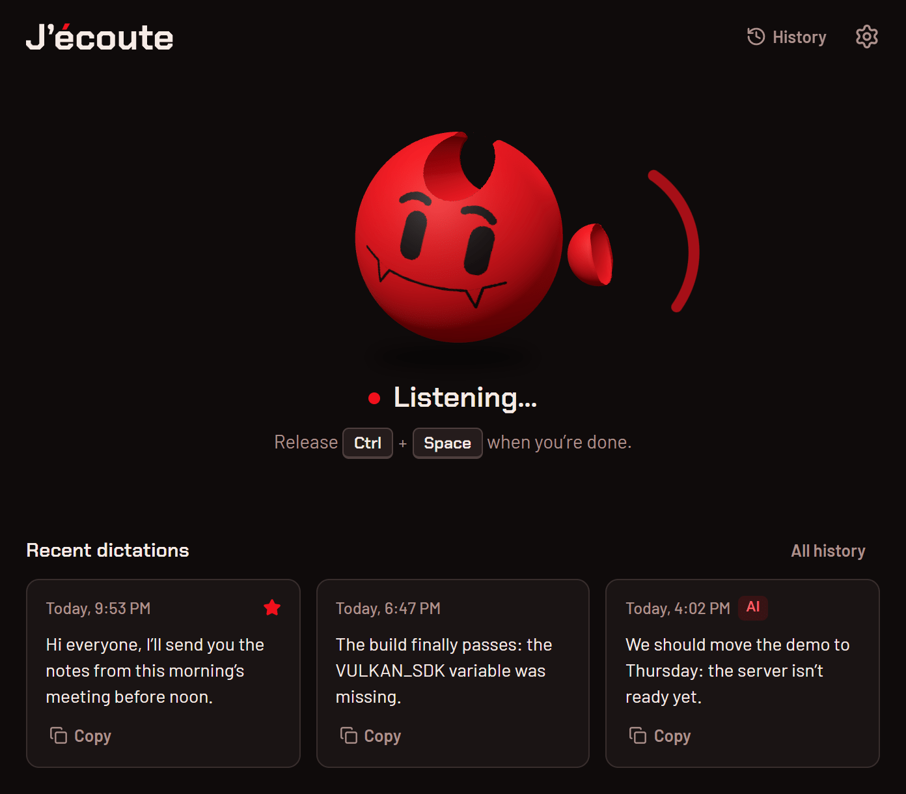
  </picture>

| Status                           | What it tells you                                                                         |
| -------------------------------- | ----------------------------------------------------------------------------------------- |
| “Ready”                          | “Hold Ctrl+Space and speak: I write wherever your cursor is.”                             |
| “Listening…”                     | “Release Ctrl+Space when you’re done.”                                                    |
| “Writing…”                       | the model transcribing your sentence                                                      |
| “Polishing…”                     | “The AI is reviewing your dictation.”                                                     |
| “Pasted”                         | “Find it in your recent dictations.”                                                      |
| “Loading the model…”             | “A few seconds after startup, then I stay ready.”                                         |
| “Downloading Cohere Transcribe…” | the download percentage and speed                                                         |
| “I can’t hear anything”          | no microphone found; the “Choose a microphone” button opens the right setting             |
| “I can’t use the microphone”     | Windows is blocking the microphone; the “Open microphone settings” button takes you there |
| “Choose a model”                 | no model yet; the “Choose a model” button opens the list                                  |
| “The model didn’t load”          | the “Change model” button opens the list                                                  |

The character takes the matching mood: ready, loading, no microphone, error, listening, typing or whispering (see
[character.md](character.md#its-moods)).

Top right: “Calls” (see [Calls](#calls)), “History”, “Statistics” (see [Statistics](#statistics)), the settings gear,
and the “Update” button when a new version is ready.

### The pills

Below the status, two pills: the active model and the spoken language. A click opens a menu to switch models (among
the ones you downloaded, or “All models”) or languages (with a search box). During a download, a third pill shows its
progress.

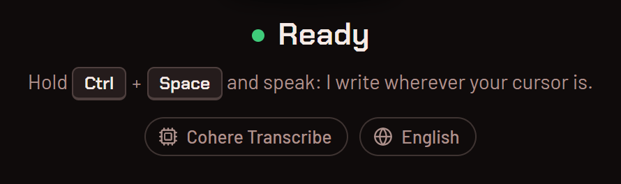

### Recent dictations

“Recent dictations”: the three latest, as cards. A click on a card copies its text (“Copied to clipboard”). An “AI”
tag marks a dictation corrected by the AI, a star marks a favorite. “All history” opens the history.

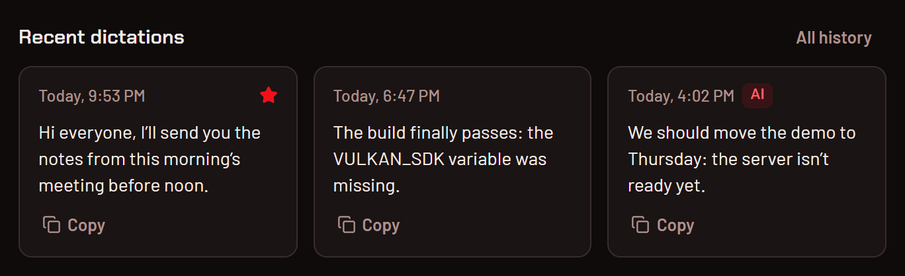

## Settings

The gear opens the settings, in five tabs: Dictation, Sound, Text, App, About. The character moves aside and reads
along with you. “Every change applies right away.”

### Dictation

  <picture>
    <source media="(prefers-color-scheme: dark)" srcset="../media/en/reglages-dictee-sombre.png">
    <source media="(prefers-color-scheme: light)" srcset="../media/en/reglages-dictee-clair.png">
    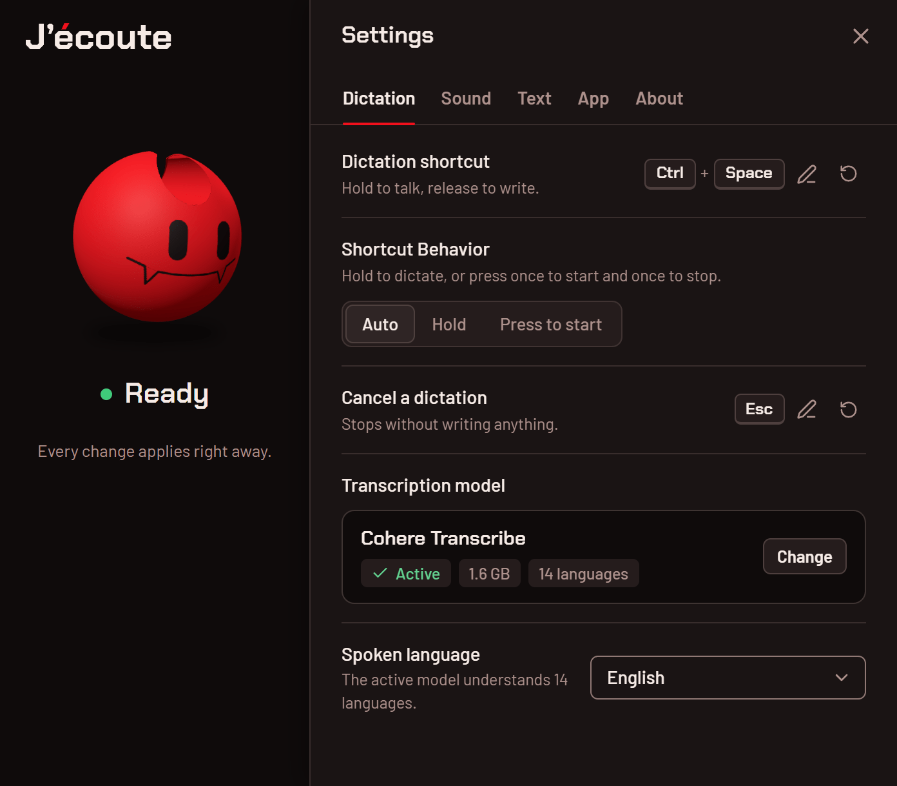
  </picture>

#### Dictation shortcut

“Hold to talk, release to write.” The keys are drawn as keycaps. The pencil (“Change”) records a new shortcut: press
the keys you want. The arrow (“Restore the default shortcut”) goes back to Ctrl+Space.

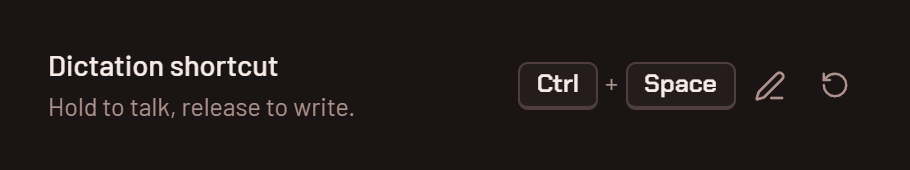

#### Shortcut behavior

“Choose how the transcribe shortcut starts and stops recording.”

| Option           | What it does                                                |
| ---------------- | ----------------------------------------------------------- |
| “Auto” (default) | “Hold to dictate, or press once to start and once to stop.” |
| “Hold”           | “I listen as long as you hold the keys.”                    |
| “Press to start” | “One press to start, another to stop.”                      |

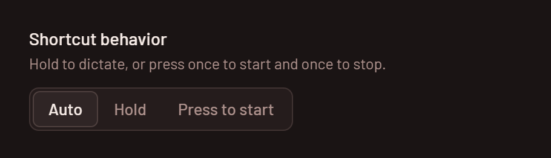

#### Cancel a dictation

“Stops without writing anything.” Default: Esc, during a dictation.

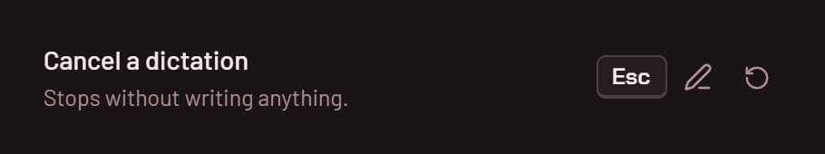

#### Transcription model

The active model, its size and how many languages it understands. “Change” opens the [model list](#models).

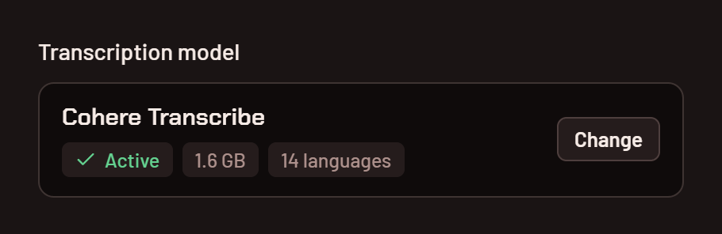

#### Spoken language

“Auto” or a specific language, with a search box. This row only shows up when the model understands several
languages. A model that cannot detect the language on its own uses the Windows language, if it knows it: the option
then reads “Auto (English)”.

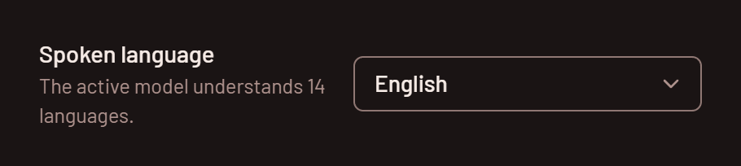

#### Translate to English

“What you say in another language is written in English.” This row only shows up with a model that can translate (for
example Canary 180M Flash or Whisper Medium).

### Sound

  <picture>
    <source media="(prefers-color-scheme: dark)" srcset="../media/en/reglages-son-sombre.png">
    <source media="(prefers-color-scheme: light)" srcset="../media/en/reglages-son-clair.png">
    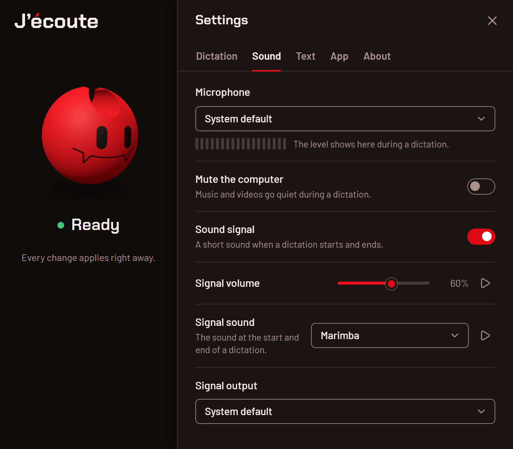
  </picture>

#### Microphone

“The microphone that listens to you.” “System default” or a specific microphone. During a dictation, its level shows
under the list (“I can hear you.”). With an audio interface that has several inputs, “Input channel” picks the input,
or “Average all channels”.

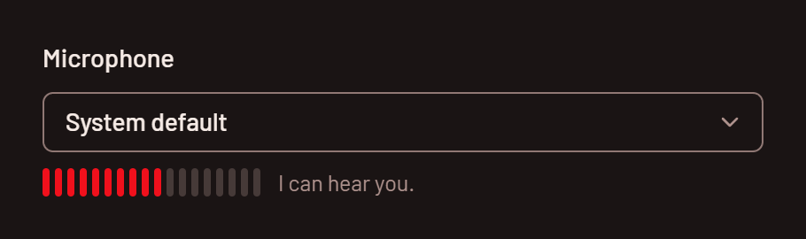

#### Mute the computer

“Music and videos go quiet during a dictation.”

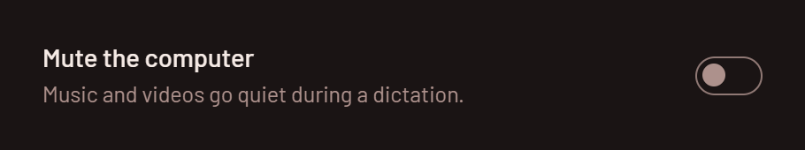

#### Sound signal

“A short sound when a dictation starts and ends.” Off by default. Once on: “Signal volume”, “Signal sound” (Marimba or
Pop, with “Play the signal”) and “Signal output” (where it plays).

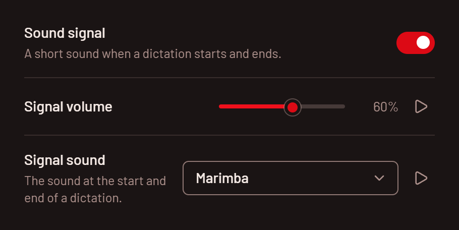

### Text

  <picture>
    <source media="(prefers-color-scheme: dark)" srcset="../media/en/reglages-texte-sombre.png">
    <source media="(prefers-color-scheme: light)" srcset="../media/en/reglages-texte-clair.png">
    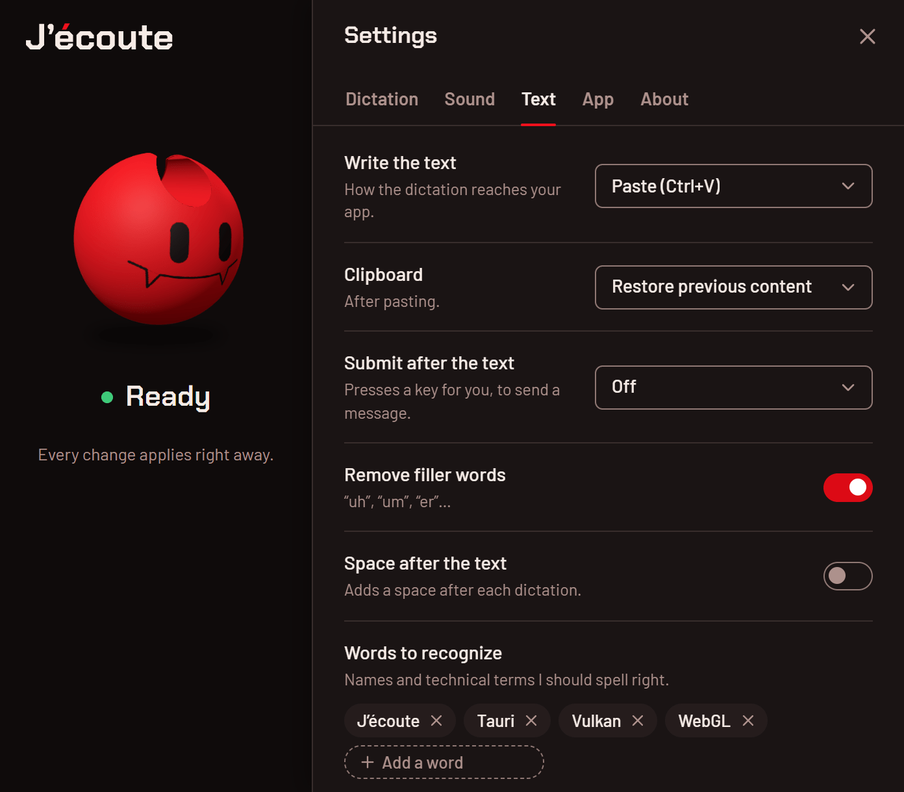
  </picture>

#### Write the text

“How the dictation reaches your app.”

| Option                                         | What it does                                                    |
| ---------------------------------------------- | --------------------------------------------------------------- |
| “Paste (Ctrl+V)” (default)                     | pastes the text in one go, through the clipboard                |
| “Type the text”                                | types the text letter by letter, without touching the clipboard |
| “Paste (Ctrl+Shift+V)”, “Paste (Shift+Insert)” | for apps that paste differently (terminals, for example)        |
| “Don’t write”                                  | the dictation only goes to the history                          |

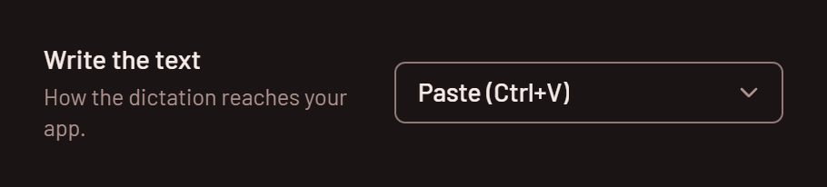

#### Clipboard

“After pasting.” “Restore previous content” (default) or “Keep the dictation” on the clipboard.

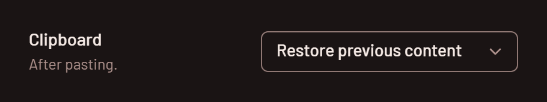

#### Submit after the text

“Presses a key for you, to send a message.” “Off” (default), “Enter”, “Ctrl+Enter” or “Super+Enter”.

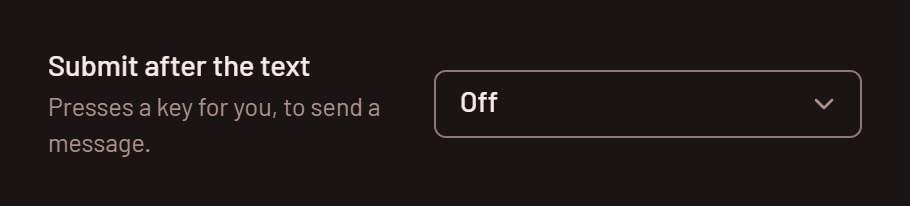

#### Remove filler words

““uh”, “um”, “er”…” disappear from the text. On by default.

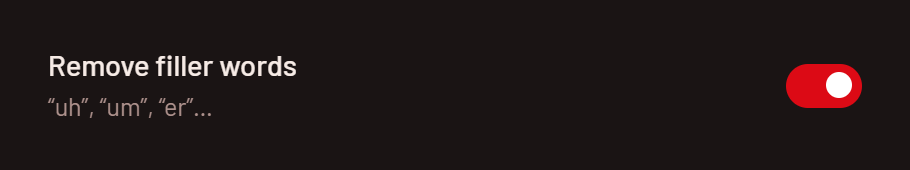

#### Space after the text

“Adds a space after each dictation.” Useful for chaining sentences. Off by default.

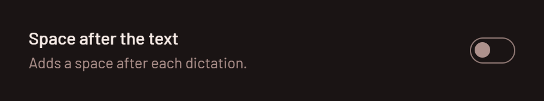

#### Words to recognize

“Names and technical terms I should spell right.” Type a word, “Add”: it becomes a tag, removed with one click.
J’écoute then corrects the close-sounding words the model hears.

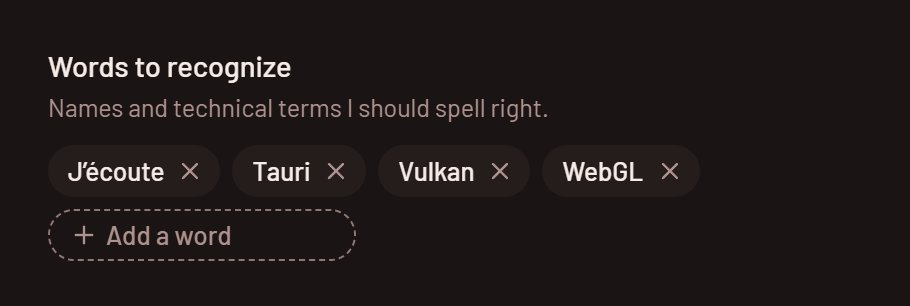

Under “Advanced options”, “Chinese script” picks Simplified or Traditional characters for Mandarin and Cantonese.

### AI correction

“An online AI reviews the dictation before pasting it. Needs an API key (OpenRouter, Anthropic, OpenAI…).” Off by
default: the switch is in the Text tab, below the words to recognize. Once it is on, the normal shortcut does not
change: the second shortcut, Ctrl+Shift+Space, is the one that has the text reviewed.

  <picture>
    <source media="(prefers-color-scheme: dark)" srcset="../media/en/reglages-texte-ia-sombre.png">
    <source media="(prefers-color-scheme: light)" srcset="../media/en/reglages-texte-ia-clair.png">
    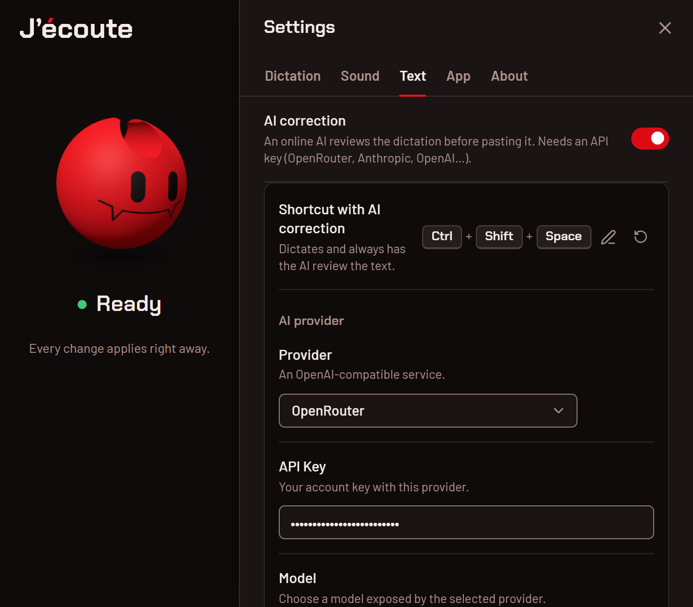
  </picture>

#### Shortcut and provider

- “Shortcut with AI correction”: “Dictates and always has the AI review the text.” Ctrl+Shift+Space by default.
- “AI provider”, then “Provider” (“An OpenAI-compatible service.”): OpenAI, Z.AI, OpenRouter, Anthropic, Groq,
  Cerebras, AWS Bedrock (Mantle), or Custom. Custom opens “API address”: a server of your own, including on your PC
  (`http://localhost:11434/v1` to start with).
- “API key”: “Your account key with this provider.”
- “Model”: a model offered by the provider, or its name typed by hand; “Refresh models” reloads the list.

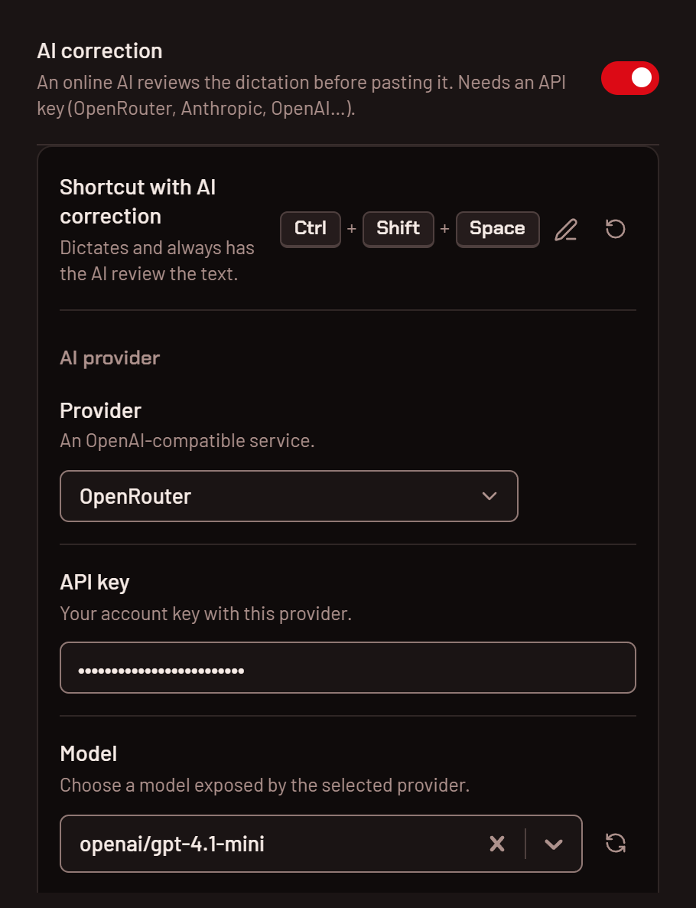

#### Instructions

“What the AI does with the text. ${output} stands for your dictation.” Pick an instruction, edit it, or write your own
with “Create new prompt” (a “Prompt label”, “Prompt instructions”, then “Create prompt”). The bundled one, Improve
Transcriptions, fixes spelling and punctuation, writes numbers as digits and removes filler words, without changing
the meaning or the language of the dictation.

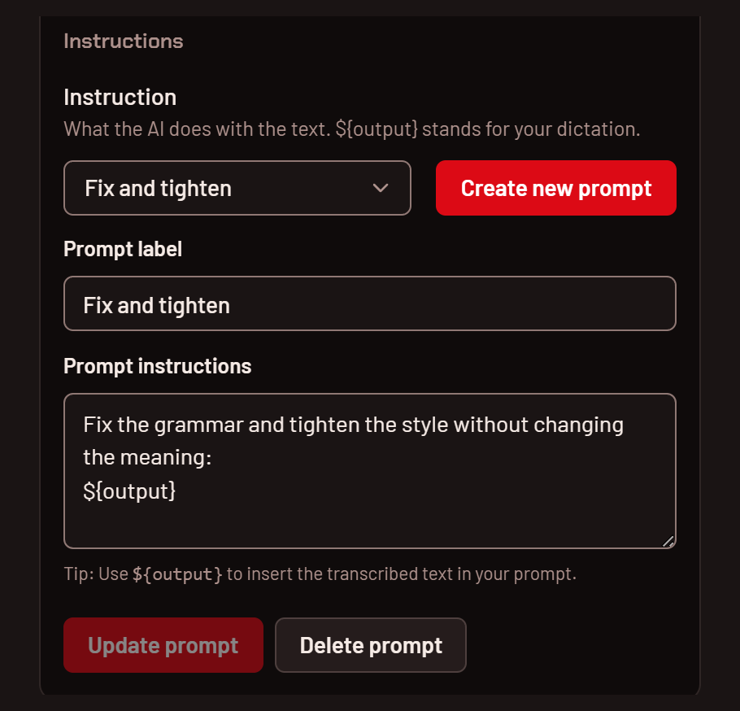

In the history, each corrected dictation keeps both versions: see [Raw or corrected](#raw-or-corrected).

### App

  <picture>
    <source media="(prefers-color-scheme: dark)" srcset="../media/en/reglages-application-sombre.png">
    <source media="(prefers-color-scheme: light)" srcset="../media/en/reglages-application-clair.png">
    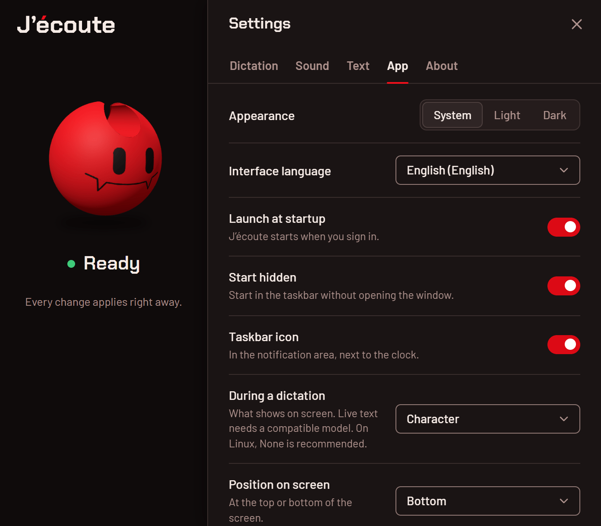
  </picture>

#### Appearance

“Choose whether J’écoute follows your system theme or stays light or dark”: “System”, “Light” or “Dark”.

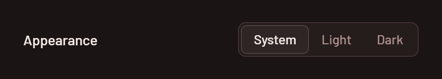

#### Interface language

The interface comes in 26 languages. By default, the Windows one.

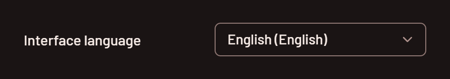

#### Startup

- “Launch at startup”: “J’écoute starts when you sign in.” Off by default.
- “Start hidden”: “Start in the taskbar without opening the window.”
- “Taskbar icon”: “In the notification area, next to the clock.” Its menu: copy the last transcript, record a call,
  switch models, unload the model, open the settings, check for updates, quit.

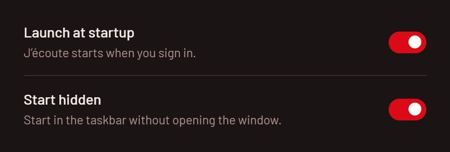

#### During a dictation

“What shows on screen.”

| Option                | What shows up                                                                                           |
| --------------------- | ------------------------------------------------------------------------------------------------------- |
| “Character” (default) | the character pops up, listens, types and slips away                                                    |
| “Live text”           | a card that shows the text while you speak (with a model that writes live; otherwise, the minimal pill) |
| “Minimal”             | a small pill: a status light, your voice level and a cross to cancel                                    |
| “None”                | nothing                                                                                                 |

With a model that writes live, “Character” also shows the live text card, instead of the character. “Position on
screen”: “Bottom” (default) or “Top”.

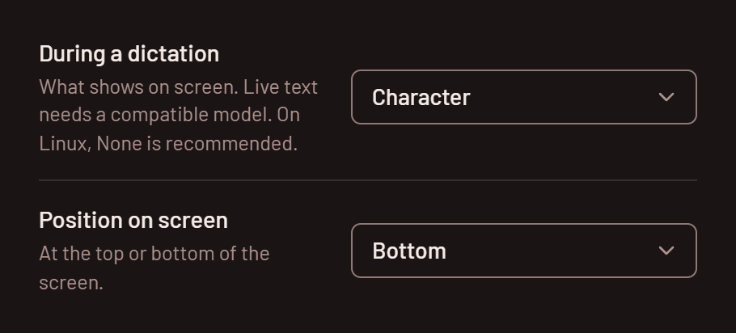

#### Free up memory

“Unloads the model when you stop dictating.” “Never” (default), “Immediately”, or after 2, 5, 10, 15 minutes or 1 hour.
The model loads again on the next dictation.

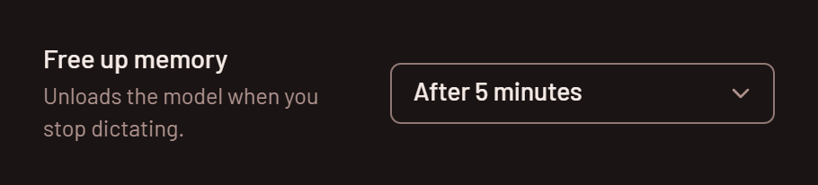

#### History size

“How many dictations are kept when “Keep dictations” is set to the latest. Favorites don’t count.” 50 by default.

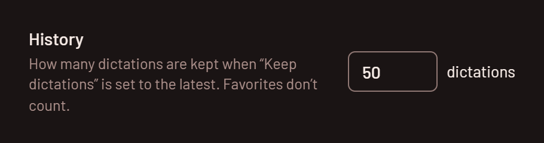

#### Keep dictations

“Older dictations (text and audio) are erased, favorites are kept.” “Latest 50” (by default: the number set in
“History”), “Forever” (nothing is erased), “3 days”, “2 weeks” or “3 months”. An erased dictation goes with its
recording; favorites always stay.

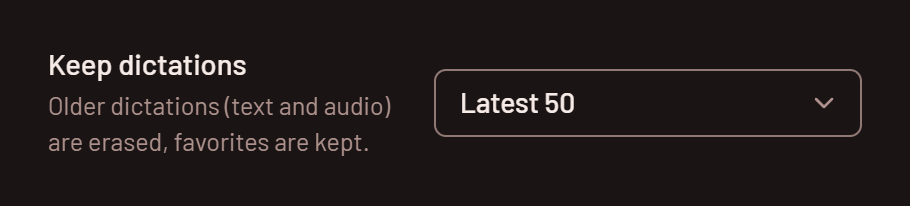

#### Updates and what’s new

“Check for updates” (on by default) looks for new versions at startup. “Show what’s new” opens the release note after
an update. Installing happens in [About](#about).

#### Advanced options

- “Voice detection”: “Ignores silence before and after speech.” On by default.
- “Experimental features”: “Features still in development.” Once on: keyboard handling, acceleration (graphics
  card or processor), “Keep the mic open between dictations” and the voice detector.
- “Debug mode”: “Shows the debug tools. Also Ctrl+Shift+D.” The “Debug” section adds the logs, the paste delays,
  “Reliable Paste (Beta)” and other fine-tuning settings.

### About

  <picture>
    <source media="(prefers-color-scheme: dark)" srcset="../media/en/reglages-a-propos-sombre.png">
    <source media="(prefers-color-scheme: light)" srcset="../media/en/reglages-a-propos-clair.png">
    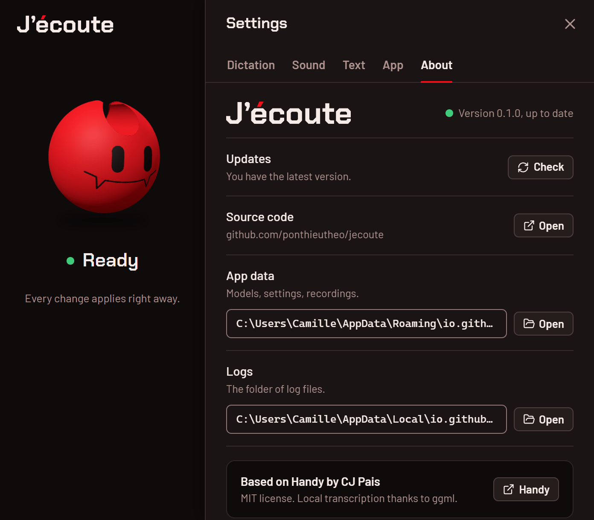
  </picture>

#### Updates

The version (“Version 0.1.0, up to date”) and “Updates”: “Check”, then “Install” when a version is available. J’écoute
restarts on the new version.

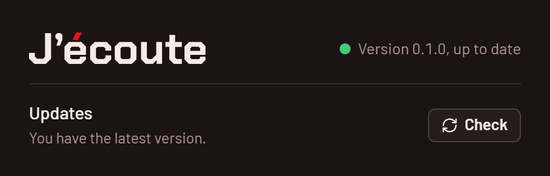

#### Folders and credits

“Source code” (github.com/ponthieutheo/jecoute), “App data” (“Models, settings, recordings.”) and “Logs” open with
one click. Below, “Based on Handy by CJ Pais”, the thanks to ggml and the character’s license.

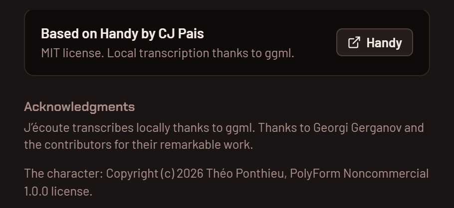

## History

“History”, at the top of the home screen (or “All history”): every dictation kept, grouped by day, updated live.

  <picture>
    <source media="(prefers-color-scheme: dark)" srcset="../media/en/historique-sombre.png">
    <source media="(prefers-color-scheme: light)" srcset="../media/en/historique-clair.png">
    
  </picture>

Each row has its buttons: “Play”, “Copy”, the star (“Add to favorites”) and “More”, which expands it: the player,
“Re-transcribe” (the same recording, transcribed again with the active model, and reviewed by the AI again if the
original was) and the trash can (“Delete”). At the bottom, the number of dictations and “Recordings folder”.

### Search

“Search”, or Ctrl+F: looks in the final text and in the raw text, across the whole history.

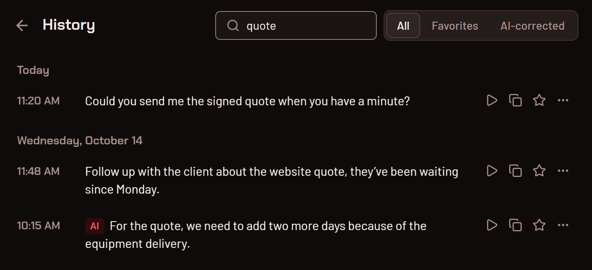

### Favorites

The star keeps a dictation for good: favorites are never erased, whatever the history limit. The “All”, “Favorites”
and “AI-corrected” filters sort the list.

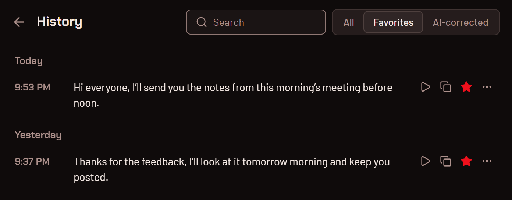

### Raw or corrected

A dictation reviewed by the AI carries the “AI” tag. Expanded, it shows the “Corrected by AI” box with the name of the
instruction, and two versions: “Corrected” (what was pasted, with the AI’s additions highlighted) and “Raw” (what the
model heard, with what the AI removed struck through).

  <picture>
    <source media="(prefers-color-scheme: dark)" srcset="../media/en/historique-brut-sombre.png">
    <source media="(prefers-color-scheme: light)" srcset="../media/en/historique-brut-clair.png">
    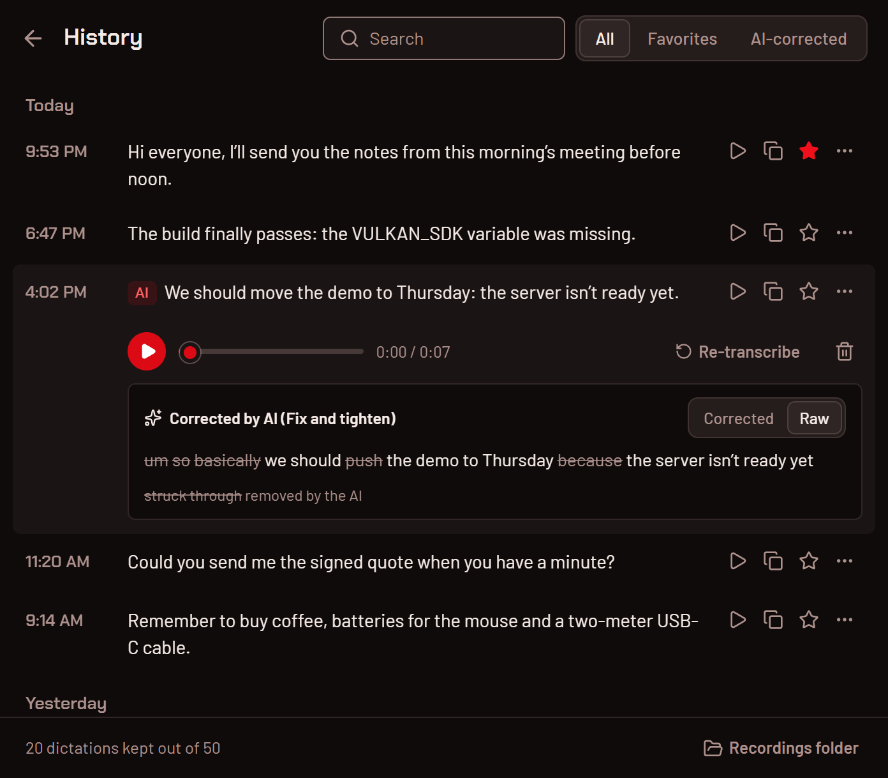
  </picture>

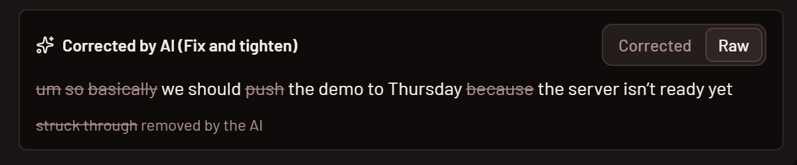

### Playback

▶ expands the row and plays the recording. Only one plays at a time; the bar lets you skip ahead or back.

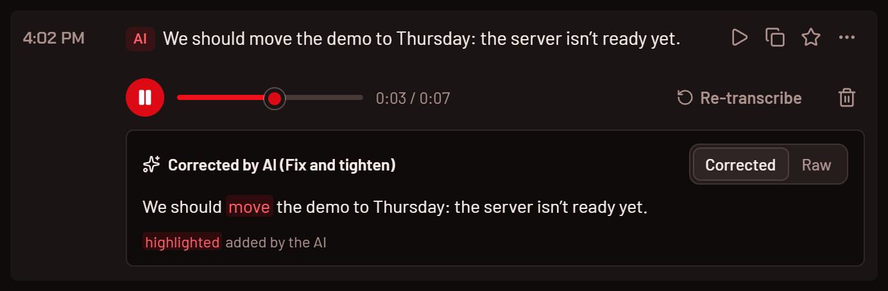

## Calls

“Calls”, at the top of the home screen: J’écoute records a call (Discord, Meet, Teams…) and puts it into words. It keeps
your microphone and the computer’s sound, that is, the other people’s voices. No bot joins the call: nothing changes for
the others, so tell them you are recording.

  <picture>
    <source media="(prefers-color-scheme: dark)" srcset="../media/en/appels-direct-sombre.png">
    <source media="(prefers-color-scheme: light)" srcset="../media/en/appels-direct-clair.png">
    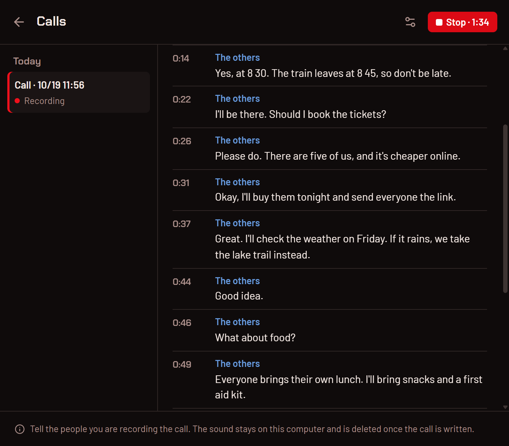
  </picture>

### Start and stop

Three ways to start recording, and the same ones to stop:

- “Record a call”, at the top of the Calls page, then “Stop” (with the length);
- “Record a call” in the tray icon menu, next to the clock, then “Stop recording the call”;
- `jecoute.exe --toggle-call`, for a shortcut or a script: it starts the call, or stops it if one is being recorded.

During the call, the home screen shows it: the timer in red instead of “Calls”, “Recording a call” under the character,
the last sentence heard, “Stop” and “See the call”.

  <picture>
    <source media="(prefers-color-scheme: dark)" srcset="../media/en/accueil-appel-sombre.png">
    <source media="(prefers-color-scheme: light)" srcset="../media/en/accueil-appel-clair.png">
    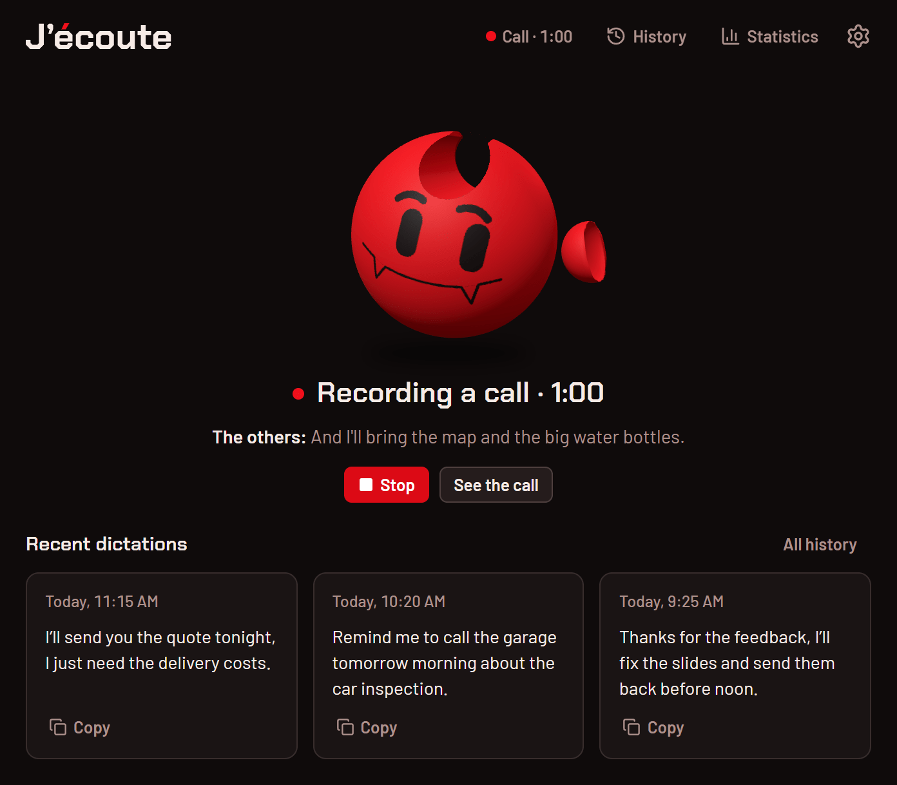
  </picture>

Dictation keeps working during a call, and it goes first: your shortcut writes your sentence as usual, the call waits
its turn.

### Live

On the Calls page, “Live”: “Each sentence appears here a few seconds after it is said.” “Me” is your microphone, “The
others” the computer’s sound. “The final version is written again when the call ends.”

### The transcript

When you stop: “Putting the call into words…”. The whole call is transcribed again with your model, person by person.
“Me” is always your microphone; the others become “Person 2”, “Person 3”… with “Separate the voices” (otherwise, “The
others”). Voices are also told apart when several people talk in front of the same PC, without a call.

  <picture>
    <source media="(prefers-color-scheme: dark)" srcset="../media/en/appels-transcription-sombre.png">
    <source media="(prefers-color-scheme: light)" srcset="../media/en/appels-transcription-clair.png">
    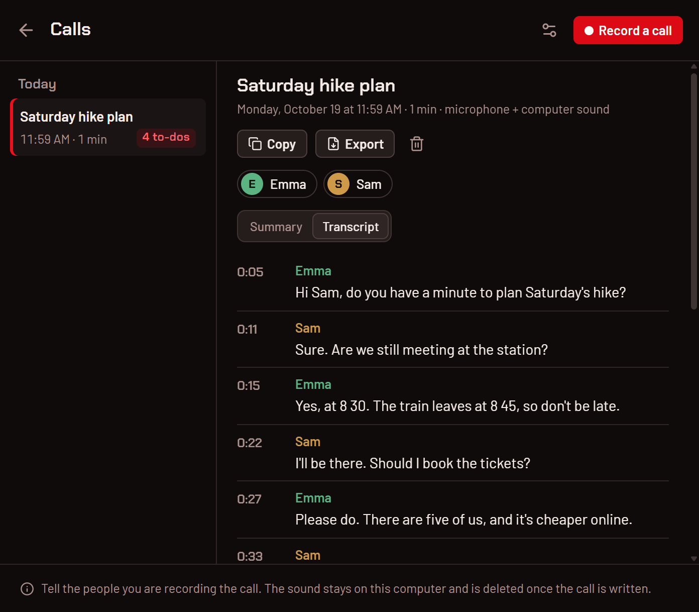
  </picture>

Click a person to give them a name (“Click to give a name”): the transcript, the copy and the export use it. The call’s
title is changed the same way.

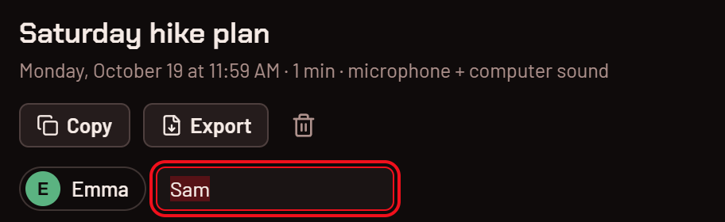

### The summary and the tasks

Once the call is written, the AI takes notes: a title, a summary in a few sentences, the “Key points” and the “Tasks”,
with who does what and when. Check a task off when it is done: the call list shows how many are left. “Redo the
summary” writes it again, for example after naming the people.

  <picture>
    <source media="(prefers-color-scheme: dark)" srcset="../media/en/appels-resume-sombre.png">
    <source media="(prefers-color-scheme: light)" srcset="../media/en/appels-resume-clair.png">
    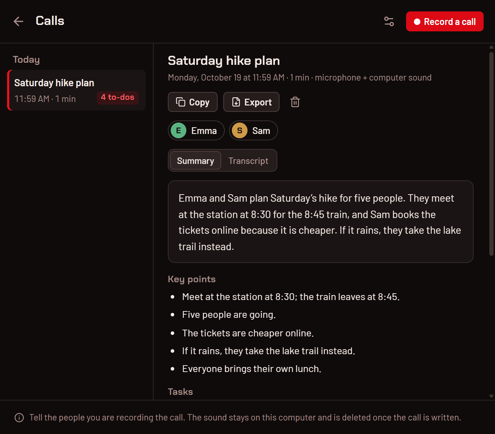
  </picture>

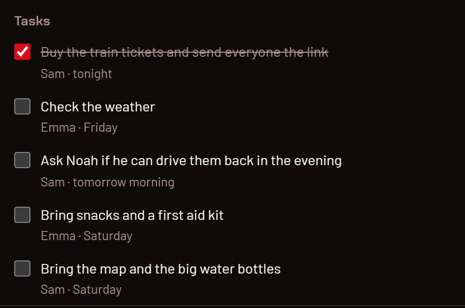

The summary is written by the AI provider set up for [AI correction](#ai-correction): J’écoute sends it the transcript,
never the sound. Without a provider, “No summary without AI”: the call keeps its transcript, with no summary or tasks.
The details: [privacy.md](privacy.md#calls).

### Copy, export, delete

“Copy” puts the call on the clipboard, in Markdown: the date, the length, the people, the summary, the key points, the
tasks, then the transcript. “Export” writes the same text to a `.md` file in your Documents folder, and shows it to you
in File Explorer. The trash can deletes the call, after you confirm.

### Call settings

The settings icon, at the top right of the Calls page:

- “Computer sound”: “Also records what the computer plays: the other people’s voices. Off: your microphone only.” On by
  default.
- “Separate the voices”: it needs a small model (29 MB), downloaded once from Hugging Face with “Download”. On by
  default.
- “AI summary”: the provider and the model that write it, or “No AI provider is set up”. On by default.
- “The microphone is the dictation one.”: “Change microphone” opens Settings › Sound.

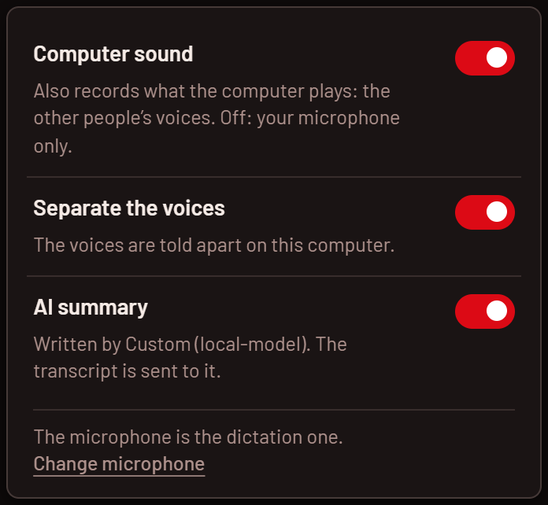

If J’écoute stops in the middle of a call (crash, “Quit”), the call is written at the next launch.

## Statistics

“Statistics”, at the top of the home screen: what dictation does for you, in numbers. Everything is counted on your
computer (“Counted on this computer, never sent.”).

  <picture>
    <source media="(prefers-color-scheme: dark)" srcset="../media/en/statistiques-sombre.png">
    <source media="(prefers-color-scheme: light)" srcset="../media/en/statistiques-clair.png">
    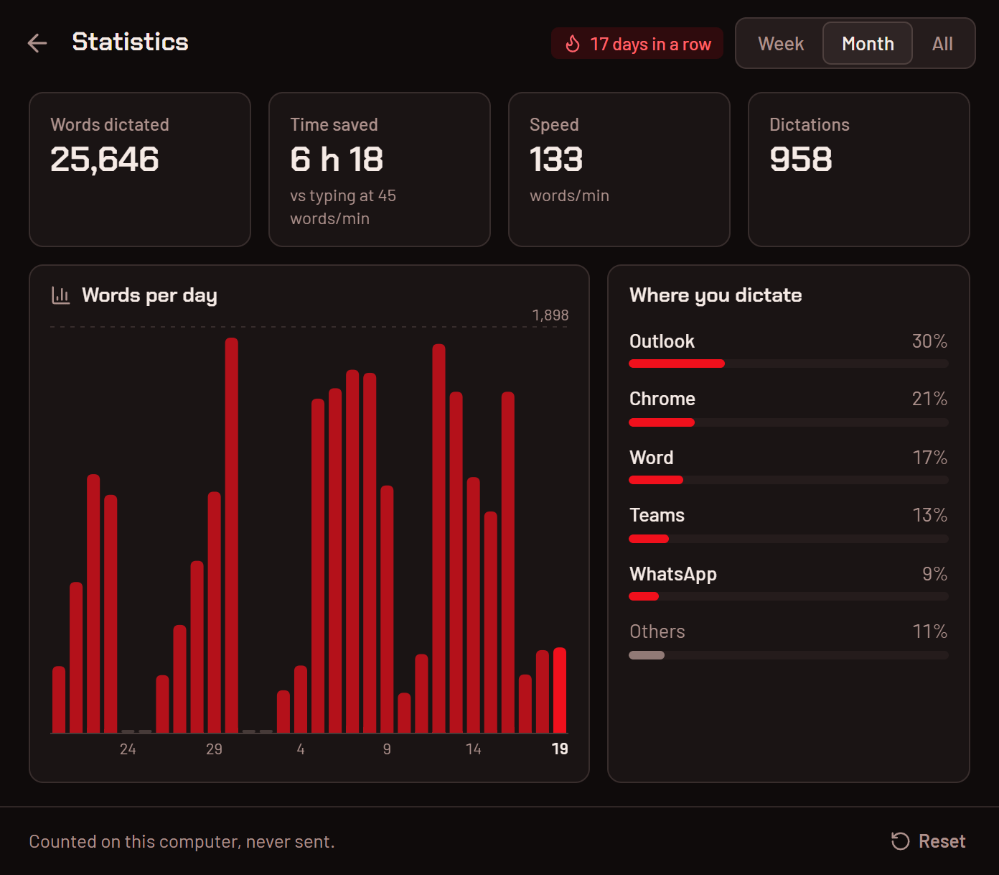
  </picture>

### The numbers

Pick the period at the top: “Week” (7 days), “Month” (30 days) or “All”.

| Number           | What it counts                                                                                |
| ---------------- | --------------------------------------------------------------------------------------------- |
| “Words dictated” | the words in your dictations                                                                  |
| “Time saved”     | the time it would have taken to type them at 45 words/min, minus the time spent saying them   |
| “Speed”          | your words per minute when you dictate                                                        |
| “Dictations”     | the number of dictations                                                                      |
| “days in a row”  | “Days in a row with at least one dictation, up to today or yesterday.” (the pill, at the top) |

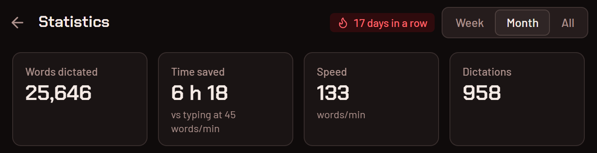

### The chart and “Where you dictate”

The chart shows your words per day (per week or per month over a long period); hover a bar to see its number. “Where
you dictate” lists the apps your dictations were pasted into, from the most used to the least: the app in the
foreground when pasting, only the program’s name.

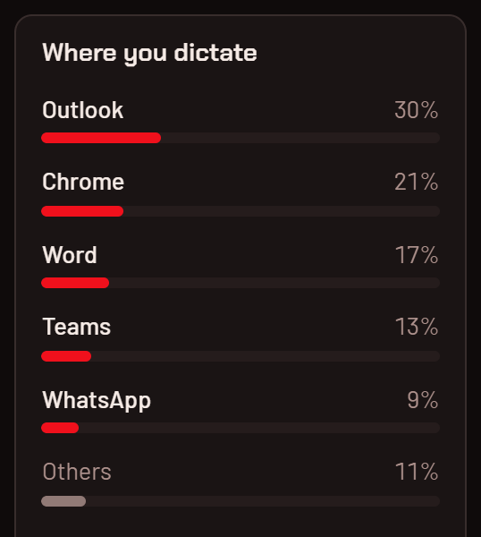

### Where the numbers come from

The statistics have their own counter: clearing the history does not erase them. On the first launch of 0.2.0,
J’écoute picks up the dictations still in your history with their recording (without the apps, which it did not know).
Before your first dictation, the page says “No numbers yet”.

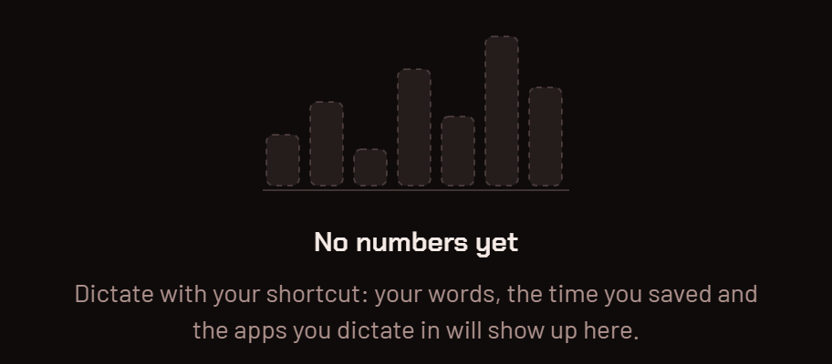

“Reset”, at the bottom, erases all the numbers, after you confirm. Your dictation history is not touched.

## Models

“Change” (Settings › Dictation), “All models” (model pill) or “Choose a model” open the list: the 69 models of the
catalog, “Sorted for English.” (for the Windows language). “Downloaded models” at the top, “Available to download”
below. How to choose: [models.md](models.md).

  <picture>
    <source media="(prefers-color-scheme: dark)" srcset="../media/en/modeles-sombre.png">
    <source media="(prefers-color-scheme: light)" srcset="../media/en/modeles-clair.png">
    
  </picture>

Each model shows its tags (“Recommended”, “Live text”), its description, its “Accuracy” and “Speed” bars,
“Translates to English” if it can translate, its size and languages (“1.6 GB, 14 languages”).

### Filters

“Search” by name. The icons filter: the globe by language (“All languages” or one language), the waves (“Filter models
that support live streaming transcription”), translation (“Filter models that support translation to English”). The
circular arrow: “Rescan for models added to the models folder or Hugging Face cache outside J’écoute”.

### Download, use, delete

“Download”: the bar moves, with the speed, and “Cancel”. Then “Verifying...” and the model moves to “Downloaded
Models”. A model that finishes downloading becomes the active model. “Use” picks another one; the trash can deletes it
(after confirmation).

## First launch

“Welcome to J’écoute”: “Choose the model that transcribes your voice. It runs on your computer, nothing goes online.”
Three models are suggested for your language and your machine (“Recommended for English” on the first one); “See the
69 models” opens the rest. The button says what it will do: “Download Cohere Transcribe (1.6 GB)”. You follow the
download right there, then the home screen opens.

  <picture>
    <source media="(prefers-color-scheme: dark)" srcset="../media/en/bienvenue-sombre.png">
    <source media="(prefers-color-scheme: light)" srcset="../media/en/bienvenue-clair.png">
    
  </picture>

If Windows blocks microphone access, a “Permissions required” step is added, with a button that opens the right
Windows settings.
