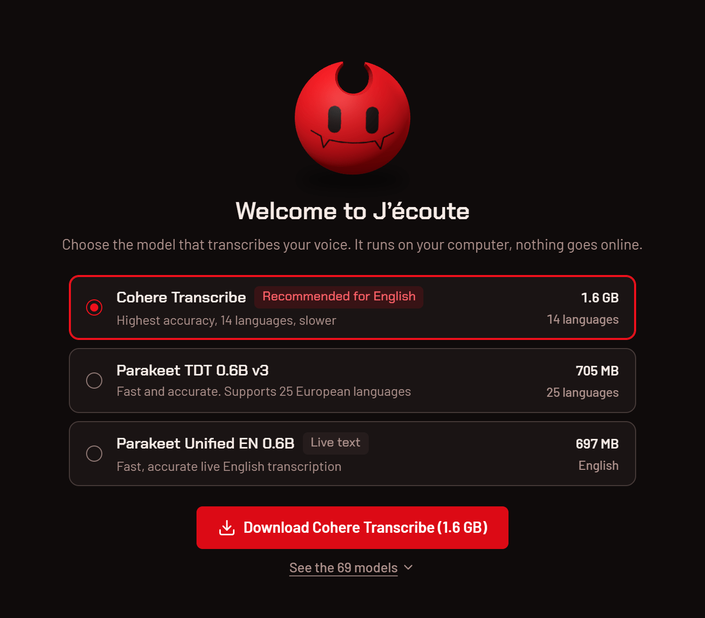

# Installing J’écoute

[Français](../installation.md) · **English**

It takes a few minutes, mostly to download the model. Getting started, on video (on-screen text in French):

https://github.com/user-attachments/assets/4e66e7b9-4aaf-48d5-8807-6908f7f5f884

## 1. What you need

- **Windows 10 or 11, 64-bit (x64).** Version 0.1.0 is only released for Windows x64: no ready-to-install macOS, Linux or ARM build
  yet. The code builds on Linux and macOS (see [BUILD.md](../../BUILD.md#linux-et-macos)); a Linux version will come
  later.
- **A microphone**: the laptop’s own, a headset or a USB mic.
- **Room for a model**: from 33 MB to 16 GB depending on the model. Cohere Transcribe, the most accurate of the ones
  J’écoute recommends, takes 1.6 GB ([models.md](models.md)).
- **A graphics card, ideally.** Models run on the graphics card (Vulkan) when there is one, otherwise on the
  processor.
- **WebView2**, the Windows display engine: it ships with Windows 11. On Windows 10, the installer downloads it from
  Microsoft if it is missing.

## 2. Download

On the [releases](https://github.com/ponthieutheo/jecoute/releases/latest) page:

| File                               | What it is for                                                   |
| ---------------------------------- | ---------------------------------------------------------------- |
| `Jecoute_<version>_x64-setup.exe`  | **the recommended installer**; it also offers a portable install |
| `Jecoute_<version>_x64_en-US.msi`  | the same app as an MSI package, for managed deployment           |
| `SHA256SUMS.txt`                   | the checksums of both installers                                 |
| `latest.json` and the `.sig` files | used by automatic updates: nothing to do with them               |

## 3. Check the file (optional)

**The SHA-256 checksum.** In PowerShell, in the download folder (replace `0.1.0` with your version):

```powershell
$expected = (Select-String -Path .\SHA256SUMS.txt -Pattern 'x64-setup.exe').Line.Split(' ')[0]
(Get-FileHash .\Jecoute_0.1.0_x64-setup.exe -Algorithm SHA256).Hash -eq $expected
```

`True`: the file is intact. The same checksums are listed in the release text.

**The provenance.** Both installers and `latest.json` carry a GitHub provenance attestation: it proves they come out
of this repository’s release workflow, untouched. With the [GitHub CLI](https://cli.github.com/) signed in to any
account (`gh auth login`):

```powershell
gh attestation verify Jecoute_0.1.0_x64-setup.exe --repo ponthieutheo/jecoute
```

Stricter, also requiring the workflow file that signed it:

```powershell
gh attestation verify Jecoute_0.1.0_x64-setup.exe --repo ponthieutheo/jecoute `
  --signer-workflow ponthieutheo/jecoute/.github/workflows/release.yml
```

The command finds the attestation from the file’s checksum, verifies its signature and shows the source repository,
workflow and commit. A file changed by even one byte has no attestation.

## 4. Install

### SmartScreen

The installer is not signed: it has no code signing certificate, and Windows does not know it yet. SmartScreen may
therefore say “Windows protected your PC”. Click “More info”, then “Run anyway”. The check in step 3 is what tells
you where the file comes from.

### Normal or portable

The installer’s “Choose Install Type” page offers two ways to install:

| Option                              | What you get                                                                                                                                                                                      |
| ----------------------------------- | ------------------------------------------------------------------------------------------------------------------------------------------------------------------------------------------------- |
| “Normal Installation (recommended)” | the app goes to `%LOCALAPPDATA%\J’écoute`, for your account only (no administrator rights needed), with a Start menu shortcut, an uninstaller and automatic updates                               |
| “Portable Installation”             | a self-contained folder (by default `J’écoute` on the Desktop): settings, history and models in its `Data\` subfolder, nothing in the registry, no shortcut, no uninstaller, no automatic updates |

The last page offers to launch J’écoute.

## 5. First launch

1. **“Welcome to J’écoute”.** Three models are suggested, chosen for your language and your machine; “See the 69
   models” opens the rest. Click the download button (“Download Cohere Transcribe (1.6 GB)”, for example): the
   model comes from Hugging Face, once.
2. **The microphone.** If Windows blocks microphone access, J’écoute tells you and opens the right settings
   (Settings → Privacy & security → Microphone).
3. **You’re set.** The home screen opens on “Ready”. Put your cursor in any app, hold Ctrl+Space, speak, let go.

<p align="center">
  <picture>
    <source media="(prefers-color-scheme: dark)" srcset="../media/en/bienvenue-sombre.png">
    <source media="(prefers-color-scheme: light)" srcset="../media/en/bienvenue-clair.png">
    
  </picture>
</p>

J’écoute then lives in the notification area, next to the clock. Closing the window does not quit it: the shortcut
keeps working. A left click on the icon brings the window back, a right click opens the menu (last transcript, model,
settings, “Quit”). To start it with Windows: Settings › App › “Launch at startup”.

## 6. Update

**Normal install.** At startup, J’écoute checks GitHub for a new version. If there is one, an “Update” button shows
up at the top of the home screen; it leads to Settings › About, where “Install” downloads the update, checks its
signature, installs it and restarts the app. Your settings, history and models stay. You can also check by hand
(“Check” in About, or “Check for Updates...” in the icon’s menu), or turn checking off (Settings › App › “Check for
updates”).

**Portable install.** It does not update itself: the “Update” button shows up too, but “Install” opens “Manual
update required”, with a “Download installer” button. Run it, pick “Portable Installation” and the same folder: the
`Data\` folder (settings, models, recordings) is kept.

## 7. Uninstall

**Normal install.** Windows Settings › Apps › Installed apps (“Apps & features” on Windows 10) › J’écoute ›
Uninstall. The uninstaller offers “Delete the application data”:

- checked, it also erases `%APPDATA%\io.github.ponthieutheo.jecoute` (settings, history, recordings, models added by
  hand) and `%LOCALAPPDATA%\io.github.ponthieutheo.jecoute` (logs, window data);
- unchecked, these folders stay, and a new install finds them again.

Downloaded models live in the Hugging Face cache, `%USERPROFILE%\.cache\huggingface\hub` (`models--handy-computer--…`
folders), shared with other tools: the uninstaller leaves it alone. To get the space back, delete them in the app
before uninstalling (the trash can in the model list), or erase those folders by hand.

**Portable install.** Quit J’écoute (right click on the icon › “Quit”), then delete its folder: everything is inside,
models included.

Where everything is stored: [privacy.md](privacy.md#where-your-data-lives).
