# Tout ce que tu peux faire dans J’écoute

**Français** · [English](en/features.md)

_Toutes les images de ce guide sont des captures de l’app, faites avec des dictées inventées. Les appels sont un
dialogue joué par des voix de synthèse, et leur résumé a été écrit pour la démo ; les chiffres des statistiques sont
inventés. Les écrans entiers suivent le thème de ton GitHub (clair ou sombre) ; les gros plans sont en thème sombre._

- [Les raccourcis clavier](#les-raccourcis-clavier)
- [L’accueil](#laccueil)
- [Les réglages](#les-réglages) : [Dictée](#dictée), [Son](#son), [Texte](#texte), [Correction par IA](#correction-par-ia),
  [Application](#application), [À propos](#à-propos)
- [L’historique](#lhistorique)
- [Les appels](#les-appels)
- [Les statistiques](#les-statistiques)
- [Les modèles](#les-modèles)
- [Le premier lancement](#le-premier-lancement)

## Les raccourcis clavier

| Touches                       | Effet                                                                                                      | Où le changer                                       |
| ----------------------------- | ---------------------------------------------------------------------------------------------------------- | --------------------------------------------------- |
| **Ctrl+Espace**               | maintenir : dicter, relâcher : écrire ; ou un appui pour démarrer, un autre pour arrêter                   | Réglages › Dictée › « Raccourci de dictée »         |
| **Échap**                     | pendant une dictée : l’annule, sans rien écrire                                                            | Réglages › Dictée › « Annuler une dictée »          |
| **Ctrl+Maj+Espace**           | dicte puis fait relire le texte par l’IA (si la correction par IA est activée)                             | Réglages › Texte › « Raccourci avec correction IA » |
| **Ctrl+Maj+D**                | dans la fenêtre : affiche ou masque les outils de débogage                                                 |                                                     |
| **Ctrl+F**                    | dans l’historique : va dans la recherche                                                                   |                                                     |
| **Échap**                     | dans l’historique : retour à l’accueil ; dans les réglages : ferme la liste des modèles, puis les réglages |                                                     |
| **←** **→** **Début** **Fin** | dans les réglages : passe d’un onglet à l’autre                                                            |                                                     |

Le raccourci de dictée et celui de la correction par IA marchent partout, même quand la fenêtre de J’écoute est
cachée.

## L’accueil

Le perso au centre, et sous lui ce que fait J’écoute, en une phrase.

  <picture>
    <source media="(prefers-color-scheme: dark)" srcset="media/fr/accueil-sombre.png">
    <source media="(prefers-color-scheme: light)" srcset="media/fr/accueil-clair.png">
    
  </picture>

Pendant une dictée, l’accueil suit en direct : le perso tend l’oreille, l’état passe à « J’écoute… ».

  <picture>
    <source media="(prefers-color-scheme: dark)" srcset="media/fr/accueil-ecoute-sombre.png">
    <source media="(prefers-color-scheme: light)" srcset="media/fr/accueil-ecoute-clair.png">
    
  </picture>

| État                                 | Ce qu’il te dit                                                             |
| ------------------------------------ | --------------------------------------------------------------------------- |
| « Prêt »                             | « Maintiens Ctrl+Espace et parle : j’écris là où se trouve ton curseur. »   |
| « J’écoute… »                        | « Relâche Ctrl+Espace quand tu as fini. »                                   |
| « J’écris… »                         | le modèle qui transcrit ta phrase                                           |
| « Je peaufine… »                     | « L’IA relit ta dictée. »                                                   |
| « C’est collé »                      | « Retrouve-la dans les dernières dictées. »                                 |
| « Je charge le modèle… »             | « Quelques secondes après le démarrage, ensuite je reste prêt. »            |
| « Je télécharge Cohere Transcribe… » | le pourcentage et la vitesse du téléchargement                              |
| « Je n’entends rien »                | aucun micro trouvé ; le bouton « Choisir un micro » ouvre le bon réglage    |
| « Je n’ai pas accès au micro »       | Windows bloque le micro ; le bouton « Ouvrir les réglages du micro » y mène |
| « Choisis un modèle »                | aucun modèle encore ; le bouton « Choisir un modèle » ouvre la liste        |
| « Le modèle n’a pas pu se charger »  | le bouton « Changer de modèle » ouvre la liste                              |

Le perso prend l’humeur qui va avec : prêt, chargement, micro absent, erreur, écoute, frappe ou chuchotement (voir
[personnage.md](personnage.md#ses-humeurs)).

En haut à droite : « Appels » (voir [Les appels](#les-appels)), « Historique », « Statistiques » (voir
[Les statistiques](#les-statistiques)), la roue dentée des réglages, et le bouton « Mise à jour » quand une nouvelle
version est prête.

### Les pastilles

Sous l’état, deux pastilles : le modèle actif et la langue parlée. Un clic ouvre un menu pour changer de modèle (parmi
ceux que tu as téléchargés, ou « Tous les modèles ») ou de langue (avec une recherche). Pendant un téléchargement, une
troisième pastille montre où il en est.

### Les dernières dictées

« Dernières dictées » : les trois plus récentes, en cartes. Un clic sur une carte copie son texte (« Copié dans le
presse-papiers »). Une pastille « IA » marque une dictée corrigée par l’IA, une étoile une dictée en favori.
« Tout l’historique » ouvre l’historique.

## Les réglages

La roue dentée ouvre les réglages, en cinq onglets : Dictée, Son, Texte, Application, À propos. Le perso se range sur
le côté et les regarde avec toi. « Chaque changement s’applique tout de suite. »

### Dictée

  <picture>
    <source media="(prefers-color-scheme: dark)" srcset="media/fr/reglages-dictee-sombre.png">
    <source media="(prefers-color-scheme: light)" srcset="media/fr/reglages-dictee-clair.png">
    
  </picture>

#### Raccourci de dictée

« Maintiens pour parler, relâche pour écrire. » Les touches sont dessinées. Le crayon (« Modifier ») enregistre un
nouveau raccourci : appuie sur les touches voulues. La flèche (« Remettre le raccourci par défaut ») revient à
Ctrl+Espace.

#### Comportement du raccourci

« Comment le raccourci démarre et arrête la dictée. »

| Choix                   | Ce que ça fait                                                                        |
| ----------------------- | ------------------------------------------------------------------------------------- |
| « Auto » (par défaut)   | « Maintiens pour dicter, ou appuie une fois pour démarrer et une fois pour arrêter. » |
| « Maintenir »           | « J’écoute tant que tu gardes les touches enfoncées. »                                |
| « Appui pour démarrer » | « Un appui pour démarrer, un autre pour arrêter. »                                    |

#### Annuler une dictée

« Arrête sans rien écrire. » Par défaut : Échap, pendant une dictée.

#### Modèle de transcription

Le modèle actif, sa taille et le nombre de langues qu’il comprend. « Changer » ouvre la [liste des modèles](#les-modèles).

#### Langue parlée

« Automatique » ou une langue précise, avec une recherche. La ligne n’apparaît que si le modèle comprend plusieurs
langues. Un modèle qui ne reconnaît pas la langue tout seul prend celle de Windows, s’il la connaît : l’option
s’affiche alors « Automatique (Français) ».

#### Traduire en anglais

« Ce que tu dis dans une autre langue est écrit en anglais. » La ligne n’apparaît qu’avec un modèle qui sait traduire
(par exemple Canary 180M Flash ou Whisper Medium).

### Son

  <picture>
    <source media="(prefers-color-scheme: dark)" srcset="media/fr/reglages-son-sombre.png">
    <source media="(prefers-color-scheme: light)" srcset="media/fr/reglages-son-clair.png">
    
  </picture>

#### Micro

« Le micro qui t’écoute. » « Par défaut du système » ou un micro précis. Pendant une dictée, son niveau s’affiche sous
la liste (« Je t’entends. »). Avec une interface audio à plusieurs entrées, « Canal d’entrée » choisit l’entrée, ou
« Moyenne de tous les canaux ».

#### Couper le son de l’ordinateur

« Pendant la dictée, la musique et les vidéos se taisent. »

#### Signal sonore

« Un petit son au début et à la fin de la dictée. » Désactivé au départ. Une fois activé : « Volume du signal », « Son du
signal » (Marimba ou Pop, avec « Écouter le signal ») et « Sortie du signal » (où il se fait entendre).

### Texte

  <picture>
    <source media="(prefers-color-scheme: dark)" srcset="media/fr/reglages-texte-sombre.png">
    <source media="(prefers-color-scheme: light)" srcset="media/fr/reglages-texte-clair.png">
    
  </picture>

#### Écrire le texte

« Comment la dictée arrive dans ton application. »

| Choix                                           | Ce que ça fait                                                       |
| ----------------------------------------------- | -------------------------------------------------------------------- |
| « Coller (Ctrl+V) » (par défaut)                | colle le texte d’un coup, par le presse-papiers                      |
| « Taper le texte »                              | tape le texte lettre par lettre, sans toucher au presse-papiers      |
| « Coller (Ctrl+Maj+V) », « Coller (Maj+Inser) » | pour les applications qui collent autrement (terminaux, par exemple) |
| « Ne rien écrire »                              | la dictée va seulement dans l’historique                             |

#### Presse-papiers

« Après le collage. » « Remettre l’ancien contenu » (par défaut) ou « Garder la dictée » dans le presse-papiers.

#### Valider après le texte

« Appuie sur une touche à ta place, pour envoyer un message. » « Non » (par défaut), « Entrée », « Ctrl+Entrée » ou
« Super+Entrée ».

#### Retirer les hésitations

« « euh », « hum », « ben »… » disparaissent du texte. Activé au départ.

#### Espace après le texte

« Ajoute une espace après chaque dictée. » Pratique pour enchaîner les phrases. Désactivé au départ.

#### Mots à reconnaître

« Noms propres et termes techniques que je dois bien écrire. » Tape un mot, « Ajouter » : il devient une étiquette, que
tu retires d’un clic. J’écoute corrige ensuite les mots proches que le modèle entend.

Dans « Options avancées », « Écriture chinoise » choisit les caractères simplifiés ou traditionnels pour le mandarin et
le cantonais.

### Correction par IA

« Une IA en ligne relit la dictée avant de la coller. Demande une clé d’API (OpenRouter, Anthropic, OpenAI…). »
Désactivée au départ : l’interrupteur est dans l’onglet Texte, sous les mots à reconnaître. Une fois activée, le
raccourci normal ne change pas : c’est le second raccourci, Ctrl+Maj+Espace, qui fait relire le texte.

  <picture>
    <source media="(prefers-color-scheme: dark)" srcset="media/fr/reglages-texte-ia-sombre.png">
    <source media="(prefers-color-scheme: light)" srcset="media/fr/reglages-texte-ia-clair.png">
    
  </picture>

#### Raccourci et fournisseur

- « Raccourci avec correction IA » : « Dicte et fait toujours relire le texte par l’IA. » Ctrl+Maj+Espace par défaut.
- « Fournisseur d’IA », puis « Fournisseur » (« Un service compatible OpenAI. ») : OpenAI, Z.AI, OpenRouter,
  Anthropic, Groq, Cerebras, AWS Bedrock (Mantle), ou Custom. Custom ouvre « Adresse de l’API » : un serveur à toi, y compris sur
  ton PC (`http://localhost:11434/v1` au départ).
- « Clé d’API » : « La clé de ton compte chez ce fournisseur. »
- « Modèle » : un modèle proposé par le fournisseur, ou son nom tapé à la main ; « Actualiser la liste » la recharge.

#### Consignes

« Ce que l’IA fait du texte. ${output} y désigne ta dictée. » Choisis une consigne, modifie-la, ou crée la tienne avec
« Nouvelle consigne » (un « Nom », des « Instructions », puis « Créer la consigne »). La consigne fournie, Improve
Transcriptions, corrige l’orthographe et la ponctuation, écrit les nombres en chiffres et retire les hésitations, sans
changer le sens ni la langue de la dictée.

Dans l’historique, chaque dictée corrigée garde ses deux versions : voir [Brut ou corrigé](#brut-ou-corrigé).

### Application

  <picture>
    <source media="(prefers-color-scheme: dark)" srcset="media/fr/reglages-application-sombre.png">
    <source media="(prefers-color-scheme: light)" srcset="media/fr/reglages-application-clair.png">
    
  </picture>

#### Apparence

« J’écoute suit le thème du système, ou reste clair ou sombre. » « Système », « Clair » ou « Sombre ».

#### Langue de l’interface

L’interface existe en 26 langues. Par défaut, celle de Windows.

#### Démarrage

- « Lancer au démarrage » : « J’écoute démarre quand tu ouvres ta session. » Désactivé au départ.
- « Démarrer masqué » : « Démarrer dans la barre des tâches sans ouvrir la fenêtre. »
- « Icône dans la barre des tâches » : « Dans la zone de notification, près de l’horloge. » Son menu : copier la
  dernière transcription, enregistrer un appel, changer de modèle, décharger le modèle, ouvrir les réglages, chercher
  une mise à jour, quitter.

#### Pendant la dictée

« Ce qui apparaît à l’écran. »

| Choix                       | Ce qui s’affiche                                                                                                       |
| --------------------------- | ---------------------------------------------------------------------------------------------------------------------- |
| « Personnage » (par défaut) | le perso surgit, écoute, tape et repart                                                                                |
| « Texte en direct »         | une carte qui montre le texte pendant que tu parles (avec un modèle qui écrit en direct ; sinon, la pastille minimale) |
| « Minimal »                 | une petite pastille : un voyant, le niveau de ta voix et une croix pour annuler                                        |
| « Aucun »                   | rien                                                                                                                   |

Avec un modèle qui écrit en direct, « Personnage » affiche aussi la carte du texte en direct, à la place du perso.
« Position à l’écran » : « En bas » (par défaut) ou « En haut ».

#### Libérer la mémoire

« Décharge le modèle quand tu ne dictes plus. » « Jamais » (par défaut), « Tout de suite », ou après 2, 5, 10,
15 minutes ou 1 heure. Le modèle se recharge à la dictée suivante.

#### Taille de l’historique

« Le nombre de dictées gardées quand « Conserver les dictées » est sur les plus récentes. Les favoris ne comptent
pas. » 50 au départ.

#### Conserver les dictées

« Les anciennes dictées (texte et audio) s’effacent, sauf les favoris. » « Les 50 plus récentes » (au départ : le
nombre réglé dans « Historique »), « Toujours » (rien ne s’efface), « 3 jours », « 2 semaines » ou « 3 mois ».
Une dictée effacée part avec son enregistrement ; les favoris restent toujours.

#### Mises à jour et nouveautés

« Vérifier les mises à jour » (activé au départ) cherche les nouvelles versions au démarrage. « Afficher les nouveautés »
ouvre la note de version après une mise à jour. L’installation se fait dans [À propos](#à-propos).

#### Options avancées

- « Détection de la voix » : « Ignore les silences avant et après la parole. » Activée au départ.
- « Fonctions expérimentales » : « Des fonctions encore en développement. » Une fois activées : la gestion du
  clavier, l’accélération (carte graphique ou processeur), « Garder le micro ouvert entre deux dictées » et le
  détecteur de voix.
- « Mode débogage » : « Affiche les outils de débogage. Aussi avec Ctrl+Maj+D. » La section « Débogage » ajoute les
  journaux, les délais de collage, « Collage fiable (bêta) » et d’autres réglages fins.

### À propos

  <picture>
    <source media="(prefers-color-scheme: dark)" srcset="media/fr/reglages-a-propos-sombre.png">
    <source media="(prefers-color-scheme: light)" srcset="media/fr/reglages-a-propos-clair.png">
    
  </picture>

#### Mises à jour

La version (« Version 0.1.0, à jour ») et « Mises à jour » : « Vérifier », puis « Installer » quand une version est
disponible. J’écoute se relance sur la nouvelle version.

#### Dossiers et crédits

« Code source » (github.com/ponthieutheo/jecoute), « Données de l’application » (« Modèles, réglages, enregistrements. »)
et « Journaux » s’ouvrent d’un clic. En dessous, « Basé sur Handy de CJ Pais », les remerciements à ggml et la licence du
perso.

## L’historique

« Historique », en haut de l’accueil (ou « Tout l’historique ») : toutes tes dictées gardées, rangées par jour, mises à
jour en direct.

  <picture>
    <source media="(prefers-color-scheme: dark)" srcset="media/fr/historique-sombre.png">
    <source media="(prefers-color-scheme: light)" srcset="media/fr/historique-clair.png">
    
  </picture>

Chaque ligne a ses boutons : « Écouter », « Copier », l’étoile (« Ajouter aux favoris ») et « Plus », qui la déplie :
le lecteur, « Retranscrire » (le même enregistrement, transcrit de nouveau avec le modèle actif, et relu par l’IA
s’il l’avait été) et la corbeille (« Supprimer »). En bas, le nombre de dictées et « Dossier des enregistrements ».

### Recherche

« Rechercher », ou Ctrl+F : cherche dans le texte final et dans le texte brut, sur tout l’historique.

### Favoris

L’étoile garde une dictée pour toujours : les favoris ne s’effacent jamais, quelle que soit la limite de l’historique.
Les filtres « Toutes », « Favoris » et « Corrigées par IA » trient la liste.

### Brut ou corrigé

Une dictée relue par l’IA porte la pastille « IA ». Dépliée, elle montre l’encadré « Corrigée par l’IA » avec le nom de
la consigne, et deux versions : « Corrigé » (ce qui a été collé, les ajouts de l’IA surlignés) et « Brut » (ce que le
modèle a entendu, ce que l’IA a retiré barré).

  <picture>
    <source media="(prefers-color-scheme: dark)" srcset="media/fr/historique-brut-sombre.png">
    <source media="(prefers-color-scheme: light)" srcset="media/fr/historique-brut-clair.png">
    
  </picture>

### Lecture

▶ déplie la ligne et lance l’enregistrement. Un seul joue à la fois ; la barre permet d’avancer ou de revenir.

## Les appels

« Appels », en haut de l’accueil : J’écoute enregistre un appel (Discord, Meet, Teams…) et le met par écrit. Il garde
ton micro et le son de l’ordinateur, c’est-à-dire la voix des autres. Aucun robot ne rejoint l’appel : rien ne change
pour les autres, alors préviens-les que tu enregistres.

  <picture>
    <source media="(prefers-color-scheme: dark)" srcset="media/fr/appels-direct-sombre.png">
    <source media="(prefers-color-scheme: light)" srcset="media/fr/appels-direct-clair.png">
    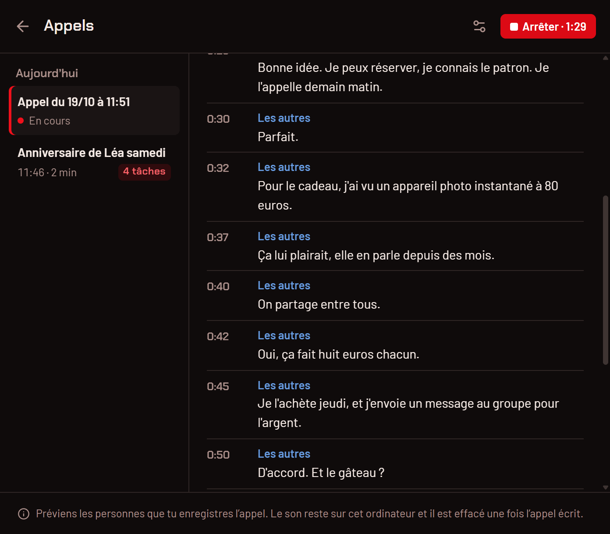
  </picture>

### Démarrer et arrêter

Trois façons de lancer l’enregistrement, et les mêmes pour l’arrêter :

- « Enregistrer un appel », en haut de la page Appels, puis « Arrêter » (avec la durée) ;
- « Enregistrer un appel » dans le menu de l’icône, près de l’horloge, puis « Arrêter l’enregistrement de l’appel » ;
- `jecoute.exe --toggle-call`, pour un raccourci ou un script : la commande démarre l’appel, ou l’arrête s’il est en
  cours.

Pendant l’appel, l’accueil le montre : le chrono en rouge à la place d’« Appels », « Appel en cours » sous le perso,
la dernière phrase entendue, « Arrêter » et « Voir l’appel ».

  <picture>
    <source media="(prefers-color-scheme: dark)" srcset="media/fr/accueil-appel-sombre.png">
    <source media="(prefers-color-scheme: light)" srcset="media/fr/accueil-appel-clair.png">
    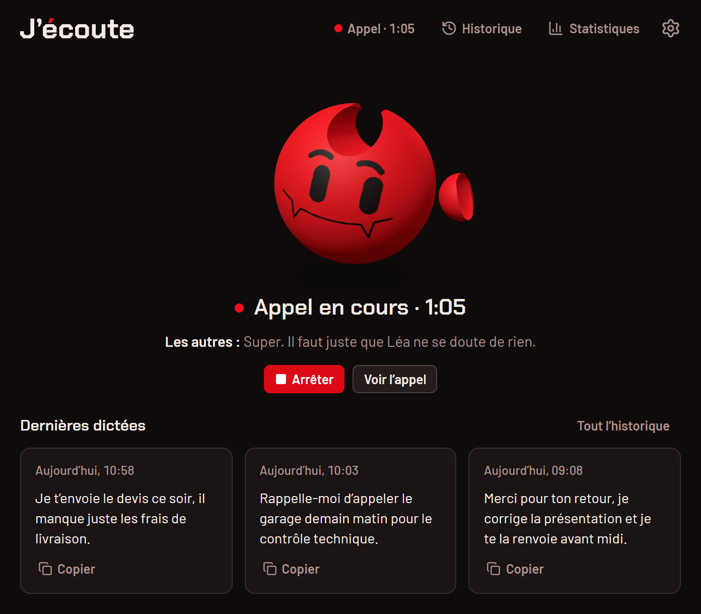
  </picture>

La dictée marche toujours pendant un appel, et elle passe en premier : ton raccourci écrit ta phrase comme d’habitude,
l’appel attend son tour.

### En direct

Sur la page Appels, « En direct » : « Chaque phrase s’affiche ici quelques secondes après avoir été dite. » « Moi »,
c’est ton micro, « Les autres », le son de l’ordinateur. « La version finale est réécrite à la fin de l’appel. »

### La transcription

Quand tu arrêtes : « Je mets l’appel par écrit… ». Tout l’appel est retranscrit avec ton modèle, personne par
personne. « Moi », c’est toujours ton micro ; les autres deviennent « Personne 2 », « Personne 3 »… avec « Distinguer
les voix » (sinon, « Les autres »). Les voix sont aussi séparées quand plusieurs personnes parlent devant le même PC,
sans appel.

  <picture>
    <source media="(prefers-color-scheme: dark)" srcset="media/fr/appels-transcription-sombre.png">
    <source media="(prefers-color-scheme: light)" srcset="media/fr/appels-transcription-clair.png">
    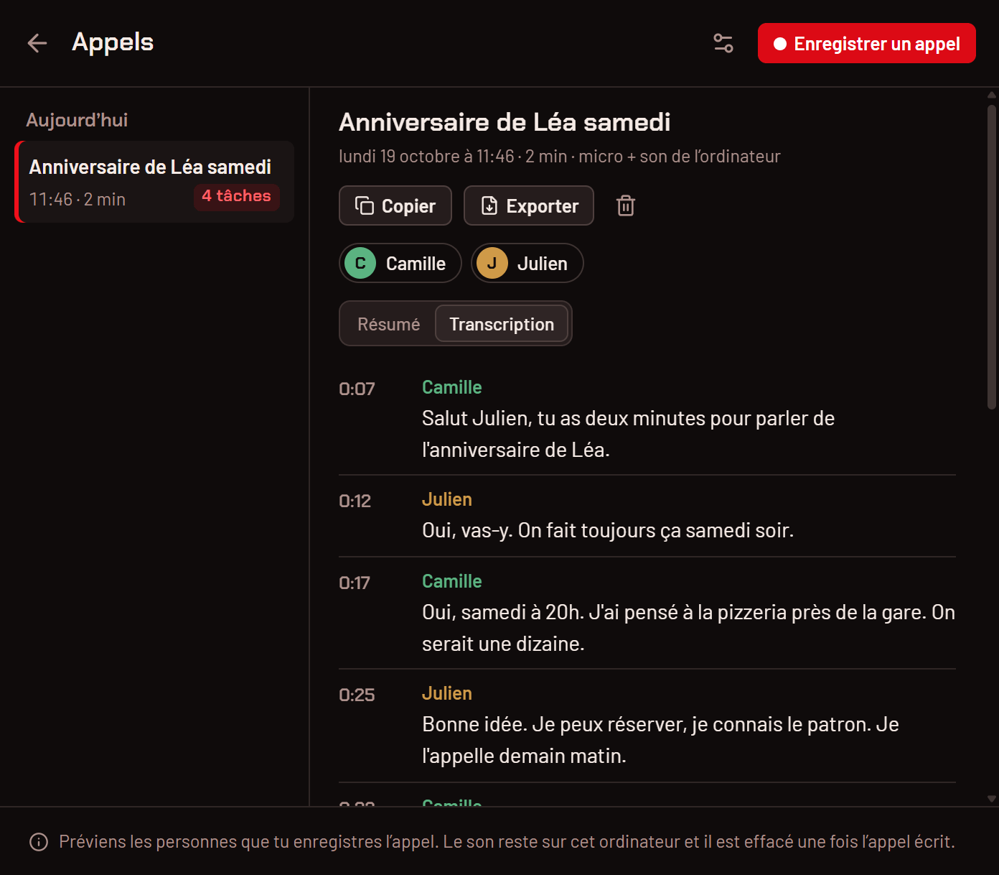
  </picture>

Clique sur une personne pour lui donner un nom (« Clique pour donner un nom ») : la transcription, la copie et
l’export le reprennent. Le titre de l’appel se change de la même façon.

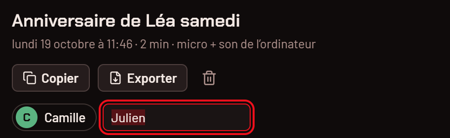

### Le résumé et les tâches

Une fois l’appel écrit, l’IA en fait la note : un titre, un résumé en quelques phrases, les « Points clés » et les
« Tâches », avec qui s’en charge et pour quand. Coche une tâche quand elle est faite : la liste des appels montre
combien il en reste. « Refaire le résumé » le réécrit, par exemple après avoir nommé les personnes.

  <picture>
    <source media="(prefers-color-scheme: dark)" srcset="media/fr/appels-resume-sombre.png">
    <source media="(prefers-color-scheme: light)" srcset="media/fr/appels-resume-clair.png">
    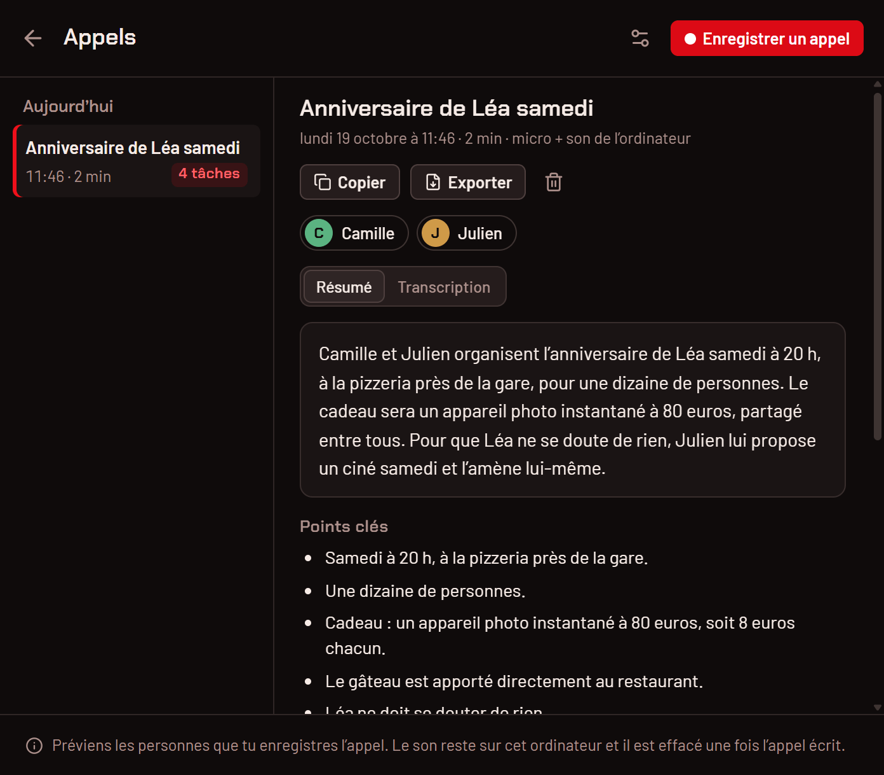
  </picture>

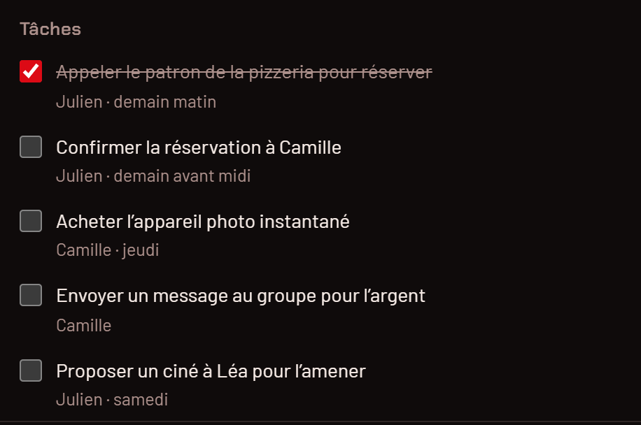

Le résumé est écrit par le fournisseur d’IA réglé pour la [correction par IA](#correction-par-ia) : J’écoute lui
envoie la transcription, jamais le son. Sans fournisseur, « Pas de résumé sans IA » : l’appel garde sa transcription,
sans résumé ni tâches. Quand le résumé est activé, le bas de la page Appels le rappelle en permanence :
« Le résumé est écrit par … : la transcription lui est envoyée. », avec « Elle quitte cet ordinateur. » si le
fournisseur n’est pas sur ton PC. Le détail : [confidentialite.md](confidentialite.md#les-appels).

### Copier, exporter, supprimer

« Copier » met l’appel dans le presse-papiers, en Markdown : la date, la durée, les personnes, le résumé, les points
clés, les tâches, puis la transcription. « Exporter » écrit le même texte dans un fichier `.md`, dans ton dossier
Documents, et te le montre dans l’Explorateur. La corbeille supprime l’appel, après confirmation.

### Réglages des appels

L’icône des réglages, en haut à droite de la page Appels :

- « Son de l’ordinateur » : « Enregistre aussi ce que joue l’ordinateur : la voix des autres. Coupé : ton micro seul. »
  Activé au départ.
- « Distinguer les voix » : il faut un petit modèle (29 Mo), téléchargé une seule fois depuis Hugging Face avec
  « Télécharger ». Activé au départ.
- « Résumé par IA » : le fournisseur et le modèle qui l’écrivent, ou « Aucun fournisseur d’IA configuré ». Activé au
  départ.
- « Le micro est celui de la dictée. » : « Changer de micro » ouvre Réglages › Son.

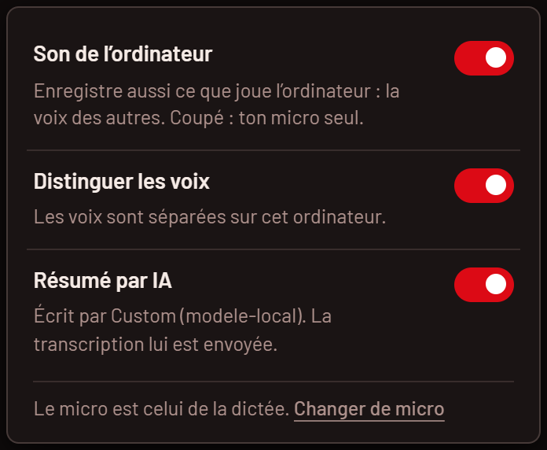

Si J’écoute s’arrête en plein appel (plantage, « Quitter »), l’appel est écrit au lancement suivant.

## Les statistiques

« Statistiques », en haut de l’accueil : ce que la dictée t’apporte, en chiffres. Tout est compté sur ton ordinateur
(« Compté sur cet ordinateur, jamais envoyé. »).

  <picture>
    <source media="(prefers-color-scheme: dark)" srcset="media/fr/statistiques-sombre.png">
    <source media="(prefers-color-scheme: light)" srcset="media/fr/statistiques-clair.png">
    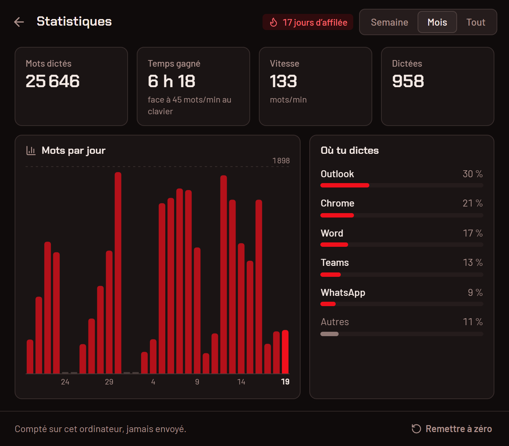
  </picture>

### Les chiffres

Choisis la période en haut : « Semaine » (7 jours), « Mois » (30 jours) ou « Tout ».

| Chiffre             | Ce qu’il compte                                                                                  |
| ------------------- | ------------------------------------------------------------------------------------------------ |
| « Mots dictés »     | les mots de tes dictées                                                                          |
| « Temps gagné »     | le temps qu’il t’aurait fallu pour les taper à 45 mots/min, moins le temps passé à les dire      |
| « Vitesse »         | tes mots par minute quand tu dictes                                                              |
| « Dictées »         | le nombre de dictées                                                                             |
| « jours d’affilée » | « Jours de suite avec au moins une dictée, jusqu’à aujourd’hui ou hier. » (la pastille, en haut) |

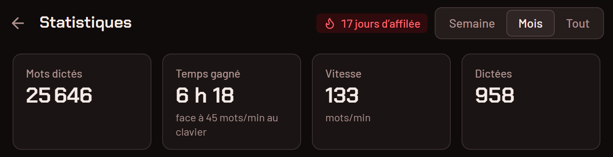

### Le graphique et « Où tu dictes »

Le graphique montre tes mots par jour (par semaine ou par mois sur une longue période) ; survole une barre pour voir
son chiffre. « Où tu dictes » range les applis où tes dictées ont été collées, de la plus utilisée à la moins
utilisée : l’appli au premier plan au moment du collage, seulement le nom du programme.

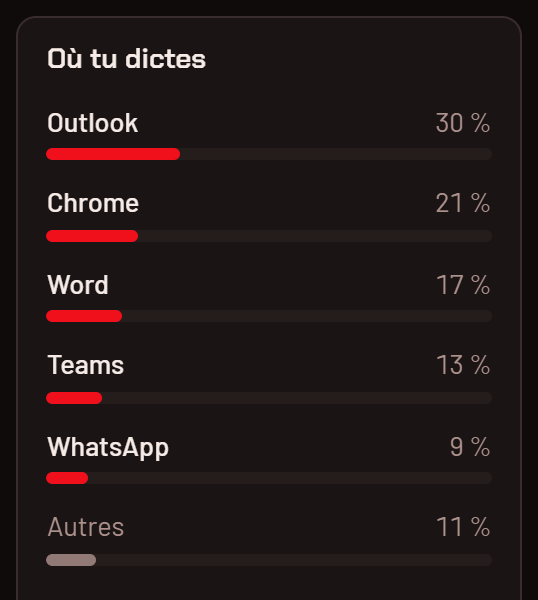

### D’où viennent les chiffres

Les statistiques ont leur propre compteur : vider l’historique ne les efface pas. Au premier lancement de la 0.2.0,
J’écoute reprend les dictées encore dans ton historique avec leur enregistrement (sans les applis, qu’il ne
connaissait pas). Avant ta première dictée, la page dit « Pas encore de chiffres ».

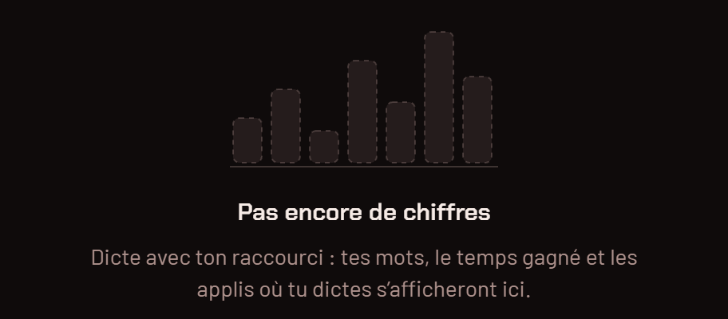

« Remettre à zéro », en bas, efface tous les chiffres, après confirmation. L’historique de tes dictées n’est pas
touché.

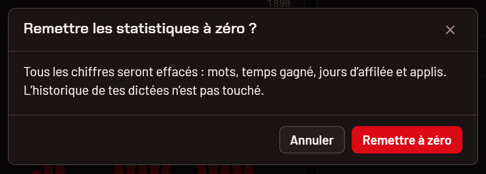

## Les modèles

« Changer » (Réglages › Dictée), « Tous les modèles » (pastille du modèle) ou « Choisir un modèle » ouvrent la liste :
les 69 modèles du catalogue, « Classés pour le français. » (pour la langue de Windows). En haut « Tes modèles », en
dessous « À télécharger ». Pour choisir : [modeles.md](modeles.md).

  <picture>
    <source media="(prefers-color-scheme: dark)" srcset="media/fr/modeles-sombre.png">
    <source media="(prefers-color-scheme: light)" srcset="media/fr/modeles-clair.png">
    
  </picture>

Chaque modèle montre ses étiquettes (« Recommandé », « Texte en direct »), sa description, ses barres « Précision » et
« Vitesse », « Traduit en anglais » s’il sait traduire, sa taille et ses langues (« 1,6 Go, 14 langues »).

### Filtres

« Rechercher » par nom. Les icônes filtrent : le globe par langue (« Toutes les langues » ou une langue), les ondes
(« Seulement les modèles qui écrivent en direct »), la traduction (« Seulement les modèles qui traduisent en anglais »).
La flèche circulaire : « Chercher les modèles ajoutés à la main (dossier des modèles ou cache Hugging Face) ».

### Télécharger, utiliser, supprimer

« Télécharger » : la barre avance, avec la vitesse, et « Annuler ». Puis « Vérification… » et le modèle passe dans « Tes
modèles ». Un modèle qui finit de se télécharger devient le modèle actif. « Utiliser » en choisit un autre ; la
corbeille le supprime (après confirmation).

## Le premier lancement

« Bienvenue dans J’écoute » : « Choisis le modèle qui transcrit ta voix. Il tourne sur ton ordinateur, rien ne part sur
Internet. » Trois modèles sont proposés pour ta langue et ta machine (« Recommandé pour le français » sur le premier) ;
« Voir les 69 modèles » ouvre le reste. Le bouton dit ce qu’il va faire : « Télécharger Cohere Transcribe (1,6 Go) ». Le
téléchargement se suit sur place, puis l’accueil s’ouvre.

  <picture>
    <source media="(prefers-color-scheme: dark)" srcset="media/fr/bienvenue-sombre.png">
    <source media="(prefers-color-scheme: light)" srcset="media/fr/bienvenue-clair.png">
    
  </picture>

Si Windows bloque l’accès au micro, une étape « Autorisations requises » s’ajoute, avec le bouton qui ouvre les bons
réglages de Windows.
