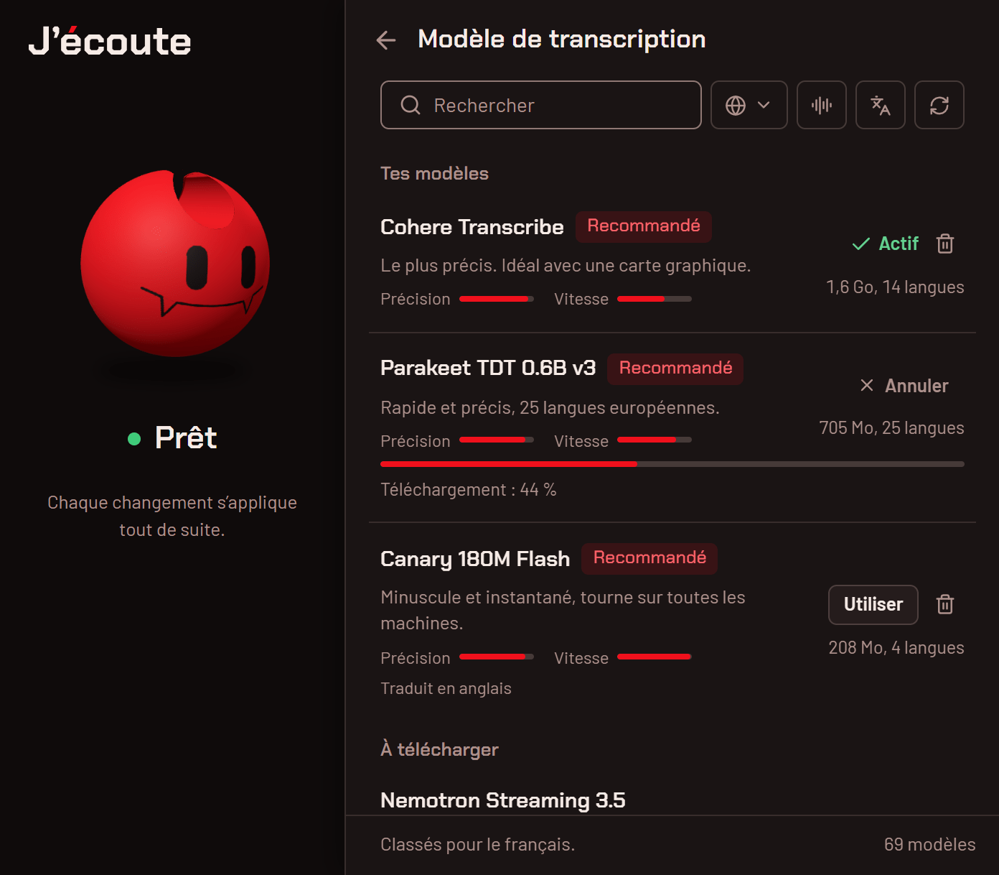

# Choisir son modèle

**Français** · [English](en/models.md)

J’écoute fait tourner un modèle de reconnaissance vocale sur ton PC. Le catalogue en compte 69, de 33 Mo à 16 Go,
tous au format GGUF, téléchargés depuis Hugging Face et exécutés avec ggml (transcribe.cpp). Tu peux en garder
plusieurs et passer de l’un à l’autre d’un clic, depuis la pastille du modèle sur l’accueil.

  <picture>
    <source media="(prefers-color-scheme: dark)" srcset="media/fr/modeles-sombre.png">
    <source media="(prefers-color-scheme: light)" srcset="media/fr/modeles-clair.png">
    
  </picture>

## Ce qui compte

1. **Ta langue.** Un modèle ne transcrit que les langues qu’il connaît : une seule pour Parakeet Unified EN 0.6B
   (l’anglais), jusqu’à 100 pour Whisper Large v3. Certains reconnaissent la langue tout seuls (Parakeet TDT 0.6B v3,
   Nemotron Streaming 3.5, Whisper). Les autres prennent la langue choisie dans « Langue parlée », ou celle de Windows
   si tu la laisses sur « Automatique ».
2. **Ta machine.** Avec une carte graphique (Vulkan), même un gros modèle précis reste rapide. Sur le processeur seul,
   un modèle de moins de 1 Go est plus agréable.
3. **Le direct.** Les modèles « Texte en direct » écrivent pendant que tu parles. La fenêtre de dictée montre alors le
   texte, à la place du perso.
4. **La traduction.** Certains modèles écrivent en anglais ce que tu dis dans une autre langue (« Traduire en
   anglais », dans Réglages › Dictée).

Dans la liste, chaque modèle a deux barres, « Précision » et « Vitesse » : ce sont les notes du catalogue, sur 100,
issues de bancs d’essai. Elles sont reprises dans les tableaux ci-dessous.

## Ce que J’écoute choisit pour toi

La liste est classée pour la langue de Windows (« Classés pour le français. »), parmi une sélection de dix modèles :

1. **avec une carte graphique**, le plus précis de la sélection qui connaît ta langue ;
2. puis le plus précis des modèles légers (jusqu’à 1 Go) qui marchent sans réglage pour ta langue : il la reconnaît
   tout seul, ou c’est la seule qu’il connaît ;
3. puis les autres modèles qui connaissent ta langue, et enfin ceux qui ne la connaissent pas.

Au premier lancement, les trois premiers sont proposés, le premier avec « Recommandé pour le français ». Si J’écoute
ne trouve pas de carte graphique, l’étape 1 saute : le modèle léger passe en tête.

## Pour le français

Les modèles qui portent l’étiquette « Recommandé » sur un Windows en français, dans l’ordre de la liste avec une carte
graphique :

| Modèle                     | Taille | Langues | Précision | Vitesse | Ce qu’il a de plus                                                                                                                            |
| -------------------------- | ------ | ------- | --------- | ------- | --------------------------------------------------------------------------------------------------------------------------------------------- |
| **Cohere Transcribe**      | 1,6 Go | 14      | 92        | 63      | le plus précis ; idéal avec une carte graphique. Il ne reconnaît pas la langue tout seul : il prend celle que tu choisis, ou celle de Windows |
| **Parakeet TDT 0.6B v3**   | 705 Mo | 25      | 88        | 79      | rapide, reconnaît la langue tout seul : le bon choix sans carte graphique, ou si tu passes du français à l’anglais                            |
| **Nemotron Streaming 3.5** | 716 Mo | 28      | 82        | 84      | texte en direct, reconnaît la langue tout seul                                                                                                |
| **Canary 180M Flash**      | 208 Mo | 4       | 88        | 98      | minuscule et instantané ; allemand, anglais, espagnol, français ; traduit en anglais                                                          |
| **Whisper Medium**         | 793 Mo | 99      | 84        | 42      | le plus de langues, traduit en anglais, plus lent                                                                                             |

Au premier lancement : Cohere Transcribe, Parakeet TDT 0.6B v3 et Nemotron Streaming 3.5 avec une carte graphique ;
Parakeet TDT 0.6B v3, Nemotron Streaming 3.5 et Canary 180M Flash sans.

## Pour l’anglais

Sur un Windows en anglais :

| Modèle                       | Taille | Langues | Précision | Vitesse | Ce qu’il a de plus                                |
| ---------------------------- | ------ | ------- | --------- | ------- | ------------------------------------------------- |
| **Cohere Transcribe**        | 1,6 Go | 14      | 92        | 63      | le plus précis ; idéal avec une carte graphique   |
| **Parakeet Unified EN 0.6B** | 697 Mo | 1       | 90        | 79      | l’anglais seulement, en direct, rapide et précis  |
| **Nemotron Streaming 3.5**   | 716 Mo | 28      | 82        | 84      | texte en direct, reconnaît la langue tout seul    |
| **Canary 180M Flash**        | 208 Mo | 4       | 88        | 98      | minuscule et instantané, traduit en anglais       |
| **Whisper Medium**           | 793 Mo | 99      | 84        | 42      | le plus de langues, traduit en anglais, plus lent |

Au premier lancement : Cohere Transcribe, Parakeet Unified EN 0.6B et Nemotron Streaming 3.5 avec une carte graphique ;
Parakeet Unified EN 0.6B, Nemotron Streaming 3.5 et Canary 180M Flash sans. Autre piste pour l’anglais seul, sans
texte en direct : Parakeet TDT 0.6B v2 (695 Mo, précision 89, vitesse 85).

## D’autres pistes

| Si tu veux                     | Regarde                                                                                          |
| ------------------------------ | ------------------------------------------------------------------------------------------------ |
| le plus léger possible         | Moonshine Tiny (33 Mo, anglais), Whisper Tiny (43 Mo, 99 langues)                                |
| le plus de langues             | Whisper Large v3 (1,1 Go, 100 langues, traduit en anglais)                                       |
| le texte en direct, en anglais | Moonshine Streaming Small (189 Mo), Moonshine Streaming Medium (282 Mo)                          |
| une autre langue               | le filtre de langue (le globe) de la liste des modèles : il ne garde que ceux qui la connaissent |

## Où sont les modèles

| Installation | Modèles téléchargés                                                                          | Modèles ajoutés à la main                         |
| ------------ | -------------------------------------------------------------------------------------------- | ------------------------------------------------- |
| normale      | `%USERPROFILE%\.cache\huggingface\hub` (le cache Hugging Face, partagé avec d’autres outils) | `%APPDATA%\io.github.ponthieutheo.jecoute\models` |
| portable     | `Data\huggingface\hub`, à côté de `jecoute.exe`                                              | `Data\models`                                     |

Un modèle du catalogue déjà dans le cache Hugging Face n’est pas retéléchargé, et les autres fichiers GGUF compatibles
qui s’y trouvent apparaissent dans la liste.

Pour ajouter un modèle à la main, copie son fichier `.gguf` dans le dossier `models` des données de l’app
(Réglages › À propos › « Données de l’application »), puis clique sur la flèche circulaire de la liste (« Chercher les
modèles ajoutés à la main (dossier des modèles ou cache Hugging Face) ») : il apparaît avec l’étiquette « Personnalisé ».

La corbeille d’un modèle le supprime du disque, cache Hugging Face compris. « Libérer la mémoire » (Réglages ›
Application) le décharge de la mémoire quand tu ne dictes plus, sans le supprimer.
