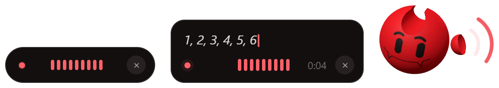
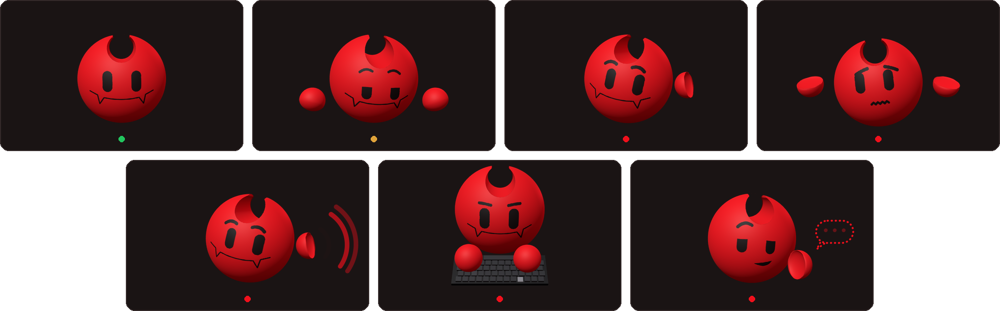

# Le perso de J’écoute

**Français** · [English](en/character.md)

Une boule rouge à cornes, en 3D, avec un visage peint et deux petites mains. Il joue dans deux scènes : la fenêtre de
dictée, qui surgit en bas de l’écran pendant que tu parles, et l’accueil de la fenêtre principale, où il vit entre deux
dictées.

_Les animations ci-dessous sont des enregistrements de l’app, sur fond transparent._

## Pendant une dictée

Tu maintiens Ctrl+Espace : il surgit d’un pop élastique, se redresse, les yeux grands ouverts, et attend ta voix.

<table>
  <tr>
    <td width="280" align="center"></td>
    <td><b>Il surgit, puis repart.</b> À la fin, un sourire et un hochement de tête. Si tu annules, il hausse les épaules, avec une goutte de sueur. En cas d’erreur, un « oups ».</td>
  </tr>
  <tr>
    <td width="280" align="center"></td>
    <td><b>Il tend l’oreille</b>, la main en cornet. Des arcs sonores suivent ta voix, et il hoche la tête de temps en temps quand tu parles.</td>
  </tr>
  <tr>
    <td width="280" align="center"></td>
    <td><b>Il tape ta phrase</b> pendant la transcription : un petit clavier noir surgit sous lui, les touches s’enfoncent sous ses mains.</td>
  </tr>
  <tr>
    <td width="280" align="center"></td>
    <td><b>Il chuchote</b> derrière sa main quand l’IA relit le texte (avec Ctrl+Maj+Espace).</td>
  </tr>
</table>

La frappe dure au moins une seconde, même quand la transcription va plus vite. Seule l’animation attend : le texte,
lui, est déjà collé.

Avec un modèle qui écrit en direct, la fenêtre de dictée montre ton texte pendant que tu parles, à la place du perso.
Les autres choix sont dans Réglages › Application › « Pendant la dictée » : « Personnage » (par défaut), « Texte en
direct », « Minimal » ou « Aucun ».

## Dans la fenêtre

Entre deux dictées, il reste au centre de l’accueil. Il respire, cligne des yeux, flotte un peu.

<table>
  <tr>
    <td width="280" align="center"></td>
    <td><b>Ses saynètes.</b> Toutes les 8 à 20 secondes, jamais la même deux fois de suite : il regarde autour de lui, s’étire, bâille, fait un tour sur lui-même, tapote des doigts, salue, tend l’oreille au silence ou fredonne.</td>
  </tr>
  <tr>
    <td width="280" align="center"></td>
    <td><b>Il suit ta souris</b>, même hors de la fenêtre : les yeux sautent de point en point, la tête suit en douceur. Quand tu ouvres les réglages, il se range sur le côté et les lit avec toi.</td>
  </tr>
  <tr>
    <td width="280" align="center"></td>
    <td><b>Un clic sur lui</b> : un sursaut, un fou rire, un « aïe » ou une pirouette. Trois clics de suite l’agacent : il boude, la tête tournée.</td>
  </tr>
  <tr>
    <td width="280" align="center"></td>
    <td><b>Il s’endort</b> après 75 secondes sans rien, et se réveille en sursaut quand la souris bouge. Si tu reviens après plus de 20 secondes ailleurs, il te salue.</td>
  </tr>
</table>

## Ses humeurs

Hors dictée, il prend l’humeur de l’accueil : prêt, chargement (il regarde la barre avancer, tapote, soupire), micro
absent (il tend l’oreille sans rien entendre, tapote son oreille, perplexe) ou erreur (gêné, après le « oups »).
Pendant une dictée : écoute, frappe, chuchotement.

  <picture>
    <source media="(prefers-color-scheme: dark)" srcset="media/perso/etats-sombre.png">
    <source media="(prefers-color-scheme: light)" srcset="media/perso/etats-clair.png">
    
  </picture>

| Humeur       | Quand                                                         |
| ------------ | ------------------------------------------------------------- |
| prêt         | « Prêt », ou juste après « C’est collé »                      |
| chargement   | le modèle se charge ou se télécharge                          |
| micro absent | aucun micro, micro bloqué par Windows, ou aucun modèle choisi |
| erreur       | le modèle n’a pas pu se charger                               |
| écoute       | tu parles                                                     |
| frappe       | la transcription                                              |
| chuchote     | la relecture par l’IA                                         |

## Léger quand on ne le regarde pas

Il tourne en 3D dans la fenêtre (WebGL), à 60 images par seconde, ou 30 si la machine peine. Il s’arrête tout à fait
quand la fenêtre est cachée ou réduite, et la fenêtre de dictée ne tourne que pendant qu’il est à l’écran. Sans WebGL,
une tête en 2D le remplace dans la fenêtre, et la fenêtre de dictée passe à la pastille minimale.

## Licence du perso

Le perso (son modèle 3D, son visage, ses animations et toutes ses images) est sous licence
**[PolyForm Noncommercial 1.0.0](../src/character/LICENSE)** :

> Required Notice: Copyright (c) 2026 Théo Ponthieu

Tu peux l’utiliser, le modifier et le partager librement pour un usage **non commercial**. Toute copie doit être
accompagnée de ces conditions et de la mention ci-dessus. Il ne fait pas partie du code MIT : pour un usage commercial
de l’app, il faut le retirer ou obtenir l’accord de son auteur.

Les dossiers concernés portent chacun ce fichier de licence : `src/character/` (le code 3D et le visage),
`src/assets/perso/`, `docs/media/perso/` (les images de cette page), `src-tauri/icons/`, `src-tauri/resources/` et
`src-tauri/nsis/` (les icônes). Le reste de J’écoute est sous [licence MIT](../LICENSE).

Pour les développeurs : le contrat entre l’app et le perso est décrit dans
[src/character/README.md](../src/character/README.md).
